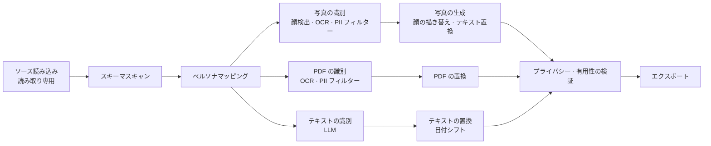

<div align="center">

[English](README.md) | [한국어](README.ko.md) | [简体中文](README.zh-CN.md) | **日本語** | [Español](README.es.md) | [Français](README.fr.md) | [Deutsch](README.de.md)


# maskara

**maskara は機微なデータを消すのではなく、一貫した合成ペルソナに置き換えます。そのため、データは AI の学習にそのまま使えます。**

[ライブデモ](https://rl-mask.vercel.app) · [クイックスタート](#クイックスタート) · [仕組み](#仕組み) · [ロードマップ](#ロードマップ) · [コントリビュート](#コントリビュート)


</div>

---

## 概要

銀行や病院のデータは機関の外に出せません。外に出すときに使われるマスキングは値を `[REDACTED]` に置き換えてしまうため、モデルの学習に必要な文脈まで失われます。
maskara は個人を特定できる値だけを**合成ペルソナ**に置き換え、診断、処方、日付の間隔、テーブル間の関係といった分析に必要な情報はそのまま残します。

| | 例（合成データ） |
|---|---|
| 元データ | `Margaret Whitaker, 67F, seen 03/02/2024 with daughter Karen. MRN 004512.` |
| 従来のマスキング | `[NAME], [AGE], seen [DATE] with daughter [NAME]. MRN [ID].` |
| **maskara** | `Linda Moreno, 67F, seen 04/11/2024 with daughter Sofia. MRN 781203.` |

患者は、患者テーブル、診療記録、PDF の記録、写真のどこに現れても**同じペルソナ**になります。日付は患者ごとに同じ幅だけずらすので、受診の間隔も保たれます。

## 機能

- **一貫したペルソナマッピング**：人物キー（MRN など）ごとにペルソナを 1 つ割り当て、その人物はすべてのテーブル・文書・画像で同じペルソナに置き換わります。
- **マルチモーダル処理**：1 回の実行で 3 種類の入力を扱います。
  - テキスト DB：構造化カラムと自由記述のメモ
  - PDF：ページごとに OCR を行い、文書全体を文脈として PII を検出
  - 写真：顔をペルソナの顔に描き替え、画像内のテキストも置き換え
- **AI によるカラムポリシーの提案**：各カラムの扱い（そのまま残す、仮名化、ペルソナ、日付シフトなど）を AI が提案し、人が確定します。
- **プライバシー・有用性レポート**：出力に元の値が残っていないかを検索し、受診間隔、年齢、テーブル間の結合、分布が保たれているかを数値で示します。
- **分析画面**：元データとマスキング後のデータに同じクエリ（フィルター、グループ化、集計）を実行し、結果を並べて比較します。
- **組み込みサンプルデータ**：合成病院データ、Synthea、Nemotron-PII、Nemotron-Personas のサンプルをワンクリックで読み込めます。
- **韓国語 / 英語 UI**：初めて使う人向けのガイドツアー付き

## クイックスタート

### 必要環境

- Node.js 20.9 以降
- pnpm 12（`corepack enable` で有効化）
- Anthropic API キー（自由記述テキストの PII 検出とカラムポリシーの提案に使用）

### インストールと実行

```bash
git clone https://github.com/return-to-the-state/RLMask.git maskara
cd maskara
pnpm install
cp .env.example .env.local   # fill in MASKING_ANTHROPIC_API_KEY
pnpm dev                     # http://localhost:3000
```

### はじめてのマスキング実行

1. サイドバーの **Datasets** を開き、**Load hospital sample** をクリックします。
2. **New masking job** で AI が各カラムに提案した扱いを確認し、実行します。
3. 実行結果の **Privacy & utility** タブで、個人データが残っていないこと、分析に使えるデータになっていることを確認します。

アプリを開くと、ガイドツアーが同じ流れを案内します。スキップするには **Skip tour** をクリックしてください。

## 仕組み

データセットは共通のステージを通ったあと、3 つのレーン（写真、PDF、テキスト）に分かれ、検証で再び合流します。



| ステージ | モデル | MVP での実行場所 | 製品（オンプレミス）での実行場所 |
|---|---|---|---|
| ソース読み込み | — | ブラウザの localStorage | 顧客 DB、読み取り専用コネクター |
| スキーマスキャン · ペルソナマッピング | — | ブラウザ | 顧客ネットワーク（マッピングテーブルは顧客の鍵で暗号化） |
| 写真 · PDF の識別 | YuNet, indra-ocr, OpenAI privacy-filter, Stanford de-identifier | チームの GPU サーバー | 顧客の GPU サーバー |
| 写真の生成 | SD 1.5 Inpainting, YuNet | チームの GPU サーバー | 顧客の GPU サーバー |
| テキストの識別 | Claude | Anthropic API | ローカル LLM（vLLM） |
| 置換 · 検証 · エクスポート | — | ブラウザ | 顧客ネットワーク |

デモを素早く出すため、MVP では**データストア（localStorage）とテキスト LLM（Anthropic API）** の 2 つだけを一時的に代替しています。それ以外のパイプラインは製品と同じコードです。設計の全体は [`planning/mvp.md`](planning/mvp.md) を参照してください。

## 設定

環境変数は `.env.local` に記述します。一覧は [`.env.example`](.env.example) にあります。

| 変数 | 必須 | 説明 |
|---|---|---|
| `MASKING_ANTHROPIC_API_KEY` | はい | 自由記述テキストの PII 検出とカラムポリシーの提案に使う Anthropic API キー |
| `OCR_API_URL` | いいえ | 写真と PDF のテキストを読み取る OCR サーバー |
| `PRIVACY_FILTER_URL` | いいえ | OCR テキストから PII を見つける privacy-filter サーバー |
| `FACE_API_URL` | いいえ | 顔検出サーバー |
| `FACE_REPAINT_URL` | いいえ | 顔をペルソナに描き替えるサーバー |

GPU サーバーの URL を空のままにすると、チームのデフォルトサーバーを使います。顔を描き替えられなかった写真は、元の顔のままエクスポートされることはなく、失敗として扱われます。

## 開発

| コマンド | 説明 |
|---|---|
| `pnpm dev` | 開発サーバーを起動（先に README.ko.md の Background セクションを同期） |
| `pnpm build` | 本番ビルド |
| `pnpm start` | ビルドを実行 |
| `pnpm lint` | ESLint を実行 |
| `pnpm sync:readme` | [`planning/subject.md`](planning/subject.md) を [README.ko.md](README.ko.md) の Background セクションにコピー |

**スタック:** Next.js 16 (App Router) · React 19 · TypeScript · Tailwind CSS 4 · shadcn/ui (Radix) · Zustand · React Query · Zod · Anthropic SDK

```text
src/
├── app/            # Pages (datasets, jobs, analysis, personas) and API routes
│   └── api/        # detect-pii, infer-roles, ocr, faces — all external model calls happen on the server
├── components/     # App UI and shadcn/ui components
└── lib/
    ├── pipeline/   # Stage definitions (stages.ts), runner (run.ts), photo and PDF processing
    ├── pii/        # privacy-filter integration, form-field rules, detection accuracy evaluation
    ├── llm/        # Claude-based PII detection and column role classification
    ├── face/ ocr/  # Face repaint store, OCR client
    └── i18n/       # English (en.ts) and Korean (ko.ts) strings
public/samples/     # Built-in sample datasets (all synthetic or public)
planning/           # Planning docs, research, slides
```

## データの取り扱いとセキュリティ

> [!WARNING]
> 現在の MVP はデモです。**実際の個人データは入れないでください。**

- 自由記述テキストは **Anthropic API** に、写真と PDF のページは **GPU サーバー**に送信されます。製品ではどちらも顧客ネットワーク内で動作します。
- データセット、実行結果、ペルソナはブラウザの localStorage と IndexedDB にのみ保存されます。
- 自動検出ですべての機微なデータを見つけられるとは限りません。エクスポートする前に、必ずプライバシーレポートと出力を自分で確認してください。

セキュリティ上の脆弱性を見つけた場合は、公開の Issue を作成せず、[GitHub Security Advisory](https://github.com/return-to-the-state/RLMask/security/advisories/new) から非公開で報告してください。

## ロードマップ

- [x] 3 レーンのパイプライン：テキスト DB、PDF、写真
- [x] テーブル・文書・画像をまたいだ一貫したペルソナマッピング
- [x] プライバシー・有用性レポートと分析比較画面
- [ ] localStorage を顧客 DB への読み取り専用コネクターに置き換え
- [ ] Anthropic API を顧客の GPU 上のローカル LLM（vLLM）に置き換え
- [ ] 閉域網向けのオフラインインストールバンドル
- [ ] 音声（通話録音）の処理

## 背景

> 米国の RL 評価・データ企業がお金を払ってでも使いたいサービス（出題：AttentionX）

### ひとことで

機微なデータを合成ペルソナに置き換え、個人情報を守りながらデータの有用性を保つサービス。

### サービス概要

従来のデータマスキングは機微なデータを隠したり削除したりするため、分析に必要な文脈まで失われることがあります。
このサービスは、顔、名前、年齢などの個人情報を**一貫した合成ペルソナ**に置き換えます。
元データの露出を減らしつつ、データの主要な特徴や関係を保つので、AI の学習、分析、テストに活用できます。

### 課題

- 銀行や病院などの機関が持つデータは**外に持ち出せません**。各機関の中に閉じ込められたままです。
- 金融 AI 企業はモデルの学習にこのデータを必要としていますが、手に入れる手段がありません。
- 機関がデータを販売する際にはマスキングが必須ですが、従来のマスキングでは学習に必要な文脈が失われてしまいます。

### 提供形態：オンプレミス導入

データを外に出せないなら、**データのある場所にこちらから出向きます。**

1. 顧客 DB に**読み取り専用**でアクセスします。
2. 顧客の環境内で非識別化します。元データが顧客の外に出ることはありません。
3. 非識別化したデータだけを、学習用や販売用にエクスポートします。

- **ローカル LLM** で動作します。外部 API を呼び出さないため、閉域網でも使えます。
- SaaS ではなく、**インストール型のソフトウェアを販売**します。
- 顧客ごとの環境に合わせた導入と継続的なアップデートが必要なため、**デプロイエンジニアリング**が事業の中核になります。

### ターゲット顧客

- 学習データを必要とする米国企業（RL 評価・データ企業）
- データを持っているが外に出せない機関（銀行、病院）
- これらの機関のデータでモデルを学習させたい金融 AI 企業

詳しい調査は [`planning/`](planning/)（韓国語）にあります：[市場分析](planning/market.html) · [顧客調査](planning/customers.html) · [リサーチノート](planning/research.html) · [ビルド計画](planning/build-plan.md)

## コントリビュート

Issue や PR を歓迎します。

1. 大きな変更の場合は、方向性をすり合わせるために先に [Issue](https://github.com/return-to-the-state/RLMask/issues) を作成してください。
2. ブランチで作業し、PR を出す前に `pnpm lint` と `pnpm build` が通ることを確認してください。
3. コミットメッセージは英語の命令形で書いてください。例：`Add date shift to the PDF lane`

知っておくと便利なこと：

- UI の文字列は `src/lib/i18n/en.ts` と `ko.ts` の**両方に**追加してください。
- この README が原文で、翻訳は `README.<lang>.md` にあります。README を変更したら翻訳も更新してください。
- [README.ko.md](README.ko.md) の Background セクションは [`planning/subject.md`](planning/subject.md) から生成されます。README ではなくそのファイルを編集し、他の README の翻訳版 Background セクションは手動で更新してください。
- このプロジェクトは Next.js 16 を使っており、API が以前のバージョンと異なります。コードを書く前に `node_modules/next/dist/docs/` のガイドを読んでください（[`AGENTS.md`](AGENTS.md) を参照）。

## 謝辞

- AttentionX — 課題の出題
- [Synthea](https://github.com/synthetichealth/synthea) (Apache-2.0) — 合成患者記録のサンプル
- [NVIDIA Nemotron-PII](https://huggingface.co/datasets/nvidia/Nemotron-PII) · [Nemotron-Personas-USA](https://huggingface.co/datasets/nvidia/Nemotron-Personas-USA) (CC BY 4.0) — PII の正解ラベル付き文書サンプルとペルソナのサンプル

## ライセンス

オープンソースライセンスはまだ決まっていません。`LICENSE` ファイルが追加されるまで、このリポジトリのコードを著作権者の許可なく使用、改変、配布することはできません。
