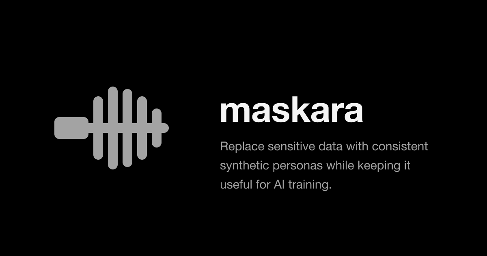
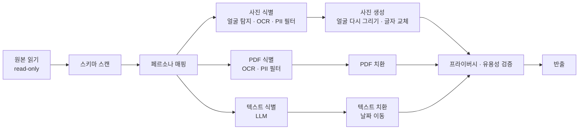

<div align="center">

[English](README.md) | **한국어** | [简体中文](README.zh-CN.md) | [日本語](README.ja.md) | [Español](README.es.md) | [Français](README.fr.md) | [Deutsch](README.de.md)



# maskara

**민감정보를 지우는 대신 일관된 가상 페르소나로 바꿔, AI가 학습할 수 있는 데이터로 남깁니다.**

[라이브 데모](https://rl-mask.vercel.app) · [빠른 시작](#빠른-시작) · [동작 방식](#동작-방식) · [로드맵](#로드맵) · [기여하기](#기여하기)


</div>

---

## 소개

은행·병원 데이터는 기관 밖으로 반출할 수 없고, 반출할 때 쓰는 기존 마스킹은 `[REDACTED]`로 지우는 과정에서 학습에 필요한 맥락까지 함께 지웁니다.
maskara는 사람을 식별하는 값만 **가상 페르소나**로 바꾸고, 진단·처방·날짜 간격·테이블 간 관계 같은 분석 정보는 그대로 둡니다.

| | 예시 (가상 데이터) |
|---|---|
| 원본 | `Margaret Whitaker, 67F, seen 03/02/2024 with daughter Karen. MRN 004512.` |
| 기존 마스킹 | `[NAME], [AGE], seen [DATE] with daughter [NAME]. MRN [ID].` |
| **maskara** | `Linda Moreno, 67F, seen 04/11/2024 with daughter Sofia. MRN 781203.` |

같은 환자는 환자 테이블, 진료 메모, PDF 기록, 사진 어디에 나오든 **같은 페르소나**로 바뀝니다. 날짜는 환자마다 같은 폭으로 이동하므로 방문 간격도 그대로 남습니다.

## 주요 기능

- **일관된 페르소나 매핑** — 사람 키(MRN 등) 하나에 페르소나 하나를 배정해, 모든 테이블·문서·이미지에서 같은 인물로 치환합니다.
- **멀티모달 처리** — 세 가지 입력을 한 번에 처리합니다.
  - 텍스트 DB: 구조화 컬럼과 자유 텍스트 메모
  - PDF: 페이지별 OCR 후 문서 전체 맥락으로 PII 탐지
  - 사진: 얼굴을 페르소나 얼굴로 다시 그리고, 이미지 속 글자도 교체
- **AI 컬럼 정책 제안** — 각 컬럼을 어떻게 처리할지(유지, 가명, 페르소나, 날짜 이동 등) AI가 제안하고 사람이 확정합니다.
- **프라이버시 · 유용성 리포트** — 결과물에 원본 값이 남았는지 검색하고, 방문 간격·나이·테이블 연결·분포가 보존됐는지 수치로 보여 줍니다.
- **분석 화면** — 원본과 마스킹본에 같은 쿼리(필터 · 그룹 · 집계)를 돌려 결과를 나란히 비교합니다.
- **샘플 데이터 내장** — 병원 합성 데이터, Synthea, Nemotron-PII, Nemotron-Personas 샘플을 바로 불러올 수 있습니다.
- **한국어 / 영어 UI**, 처음 쓰는 사람을 위한 가이드 투어

## 빠른 시작

### 요구 사항

- Node.js 20.9 이상
- pnpm 12 (`corepack enable`로 활성화)
- Anthropic API 키 (텍스트 PII 탐지와 컬럼 정책 제안에 사용)

### 설치와 실행

```bash
git clone https://github.com/return-to-the-state/RLMask.git maskara
cd maskara
pnpm install
cp .env.example .env.local   # MASKING_ANTHROPIC_API_KEY를 채웁니다
pnpm dev                     # http://localhost:3000
```

### 첫 마스킹 실행

1. 사이드바에서 **Datasets**를 열고 **Load hospital sample**을 누릅니다.
2. **New masking job**에서 AI가 제안한 컬럼별 처리 방식을 확인하고 실행합니다.
3. 실행 화면의 **Privacy & utility** 탭에서 개인정보가 남지 않았는지, 분석 가치가 유지됐는지 확인합니다.

앱을 열면 같은 흐름을 안내하는 가이드 투어가 나옵니다. **Skip tour**로 건너뛸 수 있습니다.

## 동작 방식

데이터셋 하나가 공통 단계를 거친 뒤 사진·PDF·텍스트 세 갈래로 나뉘어 처리되고, 다시 검증 단계에서 합쳐집니다.



| 단계 | 사용 모델 | MVP에서 실행되는 곳 | 실제 제품(온프레미스)에서 실행되는 곳 |
|---|---|---|---|
| 원본 읽기 | — | 브라우저 localStorage | 고객사 DB, 읽기 전용 커넥터 |
| 스키마 스캔 · 페르소나 매핑 | — | 브라우저 | 고객사 내부망 (매핑 테이블은 고객 키로 암호화) |
| 사진 · PDF 식별 | YuNet, indra-ocr, OpenAI privacy-filter, Stanford de-identifier | 팀 GPU 서버 | 고객사 GPU 서버 |
| 사진 생성 | SD 1.5 Inpainting, YuNet | 팀 GPU 서버 | 고객사 GPU 서버 |
| 텍스트 식별 | Claude | Anthropic API | 로컬 LLM (vLLM) |
| 치환 · 검증 · 반출 | — | 브라우저 | 고객사 내부망 |

MVP는 데모를 빨리 보여 주려고 **데이터 저장소(localStorage)와 텍스트 LLM(Anthropic API)** 두 곳만 임시로 대체했습니다. 나머지 파이프라인은 실제 제품과 같은 코드입니다. 자세한 설계는 [`planning/mvp.md`](planning/mvp.md)를 참고하세요.

## 설정

`.env.local`에 환경 변수를 넣습니다. 전체 목록은 [`.env.example`](.env.example)에 있습니다.

| 변수 | 필수 | 설명 |
|---|---|---|
| `MASKING_ANTHROPIC_API_KEY` | 예 | 자유 텍스트 PII 탐지와 컬럼 정책 제안에 쓰는 Anthropic API 키 |
| `OCR_API_URL` | 아니오 | 사진·PDF 텍스트를 읽는 OCR 서버 |
| `PRIVACY_FILTER_URL` | 아니오 | OCR 텍스트에서 PII를 찾는 privacy-filter 서버 |
| `FACE_API_URL` | 아니오 | 얼굴 탐지 서버 |
| `FACE_REPAINT_URL` | 아니오 | 얼굴을 페르소나로 다시 그리는 서버 |

GPU 서버 주소를 비워 두면 팀 기본 서버를 씁니다. 얼굴을 다시 그리지 못한 사진은 원본 얼굴 그대로 내보내지 않고 실패로 표시됩니다.

## 개발

| 명령 | 설명 |
|---|---|
| `pnpm dev` | 개발 서버 실행 (실행 전 README.ko.md의 배경 섹션을 자동 동기화) |
| `pnpm build` | 프로덕션 빌드 |
| `pnpm start` | 빌드 결과 실행 |
| `pnpm lint` | ESLint 검사 |
| `pnpm sync:readme` | [`planning/subject.md`](planning/subject.md) 내용을 아래 [배경](#배경) 섹션에 복사 |

**스택:** Next.js 16 (App Router) · React 19 · TypeScript · Tailwind CSS 4 · shadcn/ui (Radix) · Zustand · React Query · Zod · Anthropic SDK

```text
src/
├── app/            # 페이지(datasets, jobs, analysis, personas)와 API 라우트
│   └── api/        # detect-pii, infer-roles, ocr, faces — 외부 모델 호출은 모두 서버에서
├── components/     # 앱 UI와 shadcn/ui 컴포넌트
└── lib/
    ├── pipeline/   # 단계 정의(stages.ts)와 실행기(run.ts), 사진·PDF 처리
    ├── pii/        # privacy-filter 연동, 폼 필드 규칙, 탐지 정확도 평가
    ├── llm/        # Claude 기반 PII 탐지와 컬럼 역할 분류
    ├── face/ ocr/  # 얼굴 다시 그리기 저장소, OCR 클라이언트
    └── i18n/       # 영어(en.ts) · 한국어(ko.ts) 문구
public/samples/     # 내장 샘플 데이터셋 (모두 합성 또는 공개 데이터)
planning/           # 기획 문서, 리서치, 발표 자료
```

## 데이터 처리와 보안

> [!WARNING]
> 현재 MVP는 데모용입니다. **실제 개인정보를 넣지 마세요.**

- 자유 텍스트는 **Anthropic API**로, 사진과 PDF 페이지는 **GPU 서버**로 전송됩니다. 실제 제품에서는 이 두 곳이 모두 고객사 내부망으로 들어갑니다.
- 데이터셋, 실행 결과, 페르소나는 브라우저의 localStorage와 IndexedDB에만 저장됩니다.
- 자동 탐지가 모든 민감정보를 찾는다고 보장할 수는 없습니다. 반출 전에 프라이버시 리포트와 결과물을 반드시 직접 검토하세요.

보안 취약점을 발견했다면 공개 이슈로 올리지 말고 [GitHub Security Advisory](https://github.com/return-to-the-state/RLMask/security/advisories/new)로 비공개 제보해 주세요.

## 로드맵

- [x] 텍스트 DB · PDF · 사진 세 갈래 파이프라인
- [x] 테이블·문서·이미지 간 일관된 페르소나 매핑
- [x] 프라이버시 · 유용성 리포트와 분석 비교 화면
- [ ] localStorage를 고객사 DB 읽기 전용 커넥터로 교체
- [ ] Anthropic API를 고객사 GPU의 로컬 LLM(vLLM)으로 교체
- [ ] 폐쇄망용 오프라인 설치 번들
- [ ] 오디오(통화 녹음) 처리

## 배경

<!-- subject:start -->
> 미국 RL Eval·데이터 회사가 돈 내고 쓸 서비스 (출제 · AttentionX)

### One-liner

민감정보를 가상 페르소나로 대체해, 개인정보를 보호하면서 데이터의 활용 가치를 유지하는 서비스.

### 서비스 소개

기존 데이터 마스킹은 민감정보를 가리거나 삭제하는 과정에서 분석에 필요한 맥락까지 잃을 수 있습니다.
이 서비스는 얼굴, 이름, 연령 등의 개인정보를 **일관성 있는 가상 페르소나**로 대체합니다.
원본의 노출을 줄이면서 데이터의 주요 특성과 관계를 보존해, AI 학습·분석·테스트에 활용할 수 있도록 돕습니다.

### 문제

- 은행, 병원 같은 기관의 데이터는 **외부로 반출할 수 없습니다.** 데이터가 각 기관 안에만 묶여 있습니다.
- 금융 AI 회사는 모델을 학습시키려면 이 데이터가 필요하지만 받을 방법이 없습니다.
- 기관이 데이터를 판매할 때도 마스킹이 필수인데, 기존 마스킹은 학습에 필요한 맥락까지 지워 버립니다.

### 제공 방식: 온프레미스 설치형

데이터를 밖으로 가져올 수 없으니 **우리가 데이터가 있는 곳으로 들어갑니다.**

1. 고객사 DB에 **읽기 전용(READ only)** 으로 접근합니다.
2. 고객사 내부 환경에서 비식별화합니다. 원본은 고객사 밖으로 나가지 않습니다.
3. 비식별화된 데이터만 반출해 학습·판매에 사용합니다.

- **로컬 LLM**으로 동작합니다. 외부 API를 호출하지 않아 폐쇄망에서도 쓸 수 있습니다.
- SaaS가 아니라 **설치형 프로그램을 판매**합니다.
- 고객사 환경에 맞춘 설치와 지속적인 업데이트가 필요하므로, **배포 엔지니어링(deploy engineering)** 역량이 사업의 핵심입니다.

### 타깃 고객

- 학습용 데이터를 필요로 하는 미국 회사 (RL Eval·데이터 회사)
- 데이터를 보유했지만 반출할 수 없는 기관 (은행, 병원)
- 이 기관들의 데이터로 모델을 학습시켜야 하는 금융 AI 회사
<!-- subject:end -->

더 자세한 리서치는 [`planning/`](planning/)에 있습니다: [시장 분석](planning/market.html) · [고객사 조사](planning/customers.html) · [리서치 정리](planning/research.html) · [빌드 계획](planning/build-plan.md)

## 기여하기

이슈와 PR을 환영합니다.

1. 큰 변경은 먼저 [이슈](https://github.com/return-to-the-state/RLMask/issues)로 방향을 맞춰 주세요.
2. 브랜치를 만들어 작업하고, PR을 올리기 전에 `pnpm lint`와 `pnpm build`가 통과하는지 확인합니다.
3. 커밋 메시지는 영어 명령형으로 씁니다. 예: `Add date shift to the PDF lane`

알아 두면 좋은 규칙:

- UI 문구는 `src/lib/i18n/en.ts`와 `ko.ts`에 **함께** 추가합니다.
- 이 README의 [배경](#배경) 섹션은 자동 생성됩니다. README가 아니라 [`planning/subject.md`](planning/subject.md)를 수정하고, 다른 언어 README의 배경 섹션도 직접 번역해 함께 고칩니다.
- README의 원본은 영어 [README.md](README.md)이고, 번역본은 `README.<언어>.md`입니다. README를 고칠 때는 번역본도 함께 수정합니다.
- 이 프로젝트는 Next.js 16을 씁니다. 이전 버전과 API가 다르니 코드를 쓰기 전에 `node_modules/next/dist/docs/`의 가이드를 확인하세요 ([`AGENTS.md`](AGENTS.md) 참고).

## 감사의 말

- AttentionX — 문제 출제
- [Synthea](https://github.com/synthetichealth/synthea) (Apache-2.0) — 합성 환자 기록 샘플
- [NVIDIA Nemotron-PII](https://huggingface.co/datasets/nvidia/Nemotron-PII) · [Nemotron-Personas-USA](https://huggingface.co/datasets/nvidia/Nemotron-Personas-USA) (CC BY 4.0) — PII 정답 키가 있는 문서와 페르소나 샘플

## 라이선스

아직 오픈소스 라이선스를 정하지 않았습니다. `LICENSE` 파일이 추가되기 전까지 이 저장소의 코드는 저작권자의 허락 없이 사용·수정·배포할 수 없습니다.
