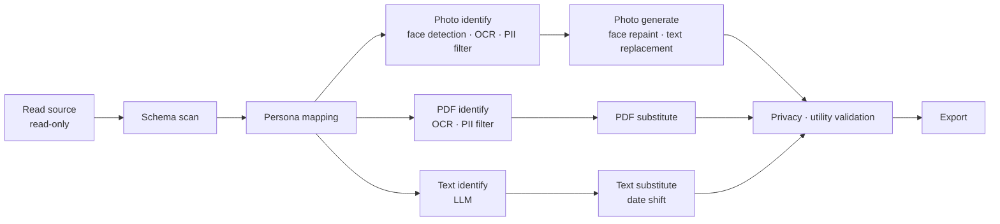

<div align="center">

**English** | [한국어](docs/i18n/README.ko.md) | [简体中文](docs/i18n/README.zh-CN.md) | [日本語](docs/i18n/README.ja.md) | [Español](docs/i18n/README.es.md) | [Français](docs/i18n/README.fr.md) | [Deutsch](docs/i18n/README.de.md)


# maskara

**Instead of erasing sensitive data, maskara swaps it for consistent synthetic personas, so the data stays usable for AI training.**

[Live demo](https://rl-mask.vercel.app) · [Quick start](#quick-start) · [How it works](#how-it-works) · [Roadmap](#roadmap) · [Contributing](#contributing)


https://github.com/user-attachments/assets/9f8c173c-8290-444c-8a75-a590fc4b9fdb

</div>

---

## About

Bank and hospital data can't leave the institution, and the masking used when it does leave replaces values with `[REDACTED]`, wiping out the context a model needs to learn from.
maskara replaces only the values that identify a person with a **synthetic persona** and leaves the analytical information alone: diagnoses, prescriptions, the gaps between dates, and the relationships between tables.

| | Example (synthetic data) |
|---|---|
| Original | `Margaret Whitaker, 67F, seen 03/02/2024 with daughter Karen. MRN 004512.` |
| Conventional masking | `[NAME], [AGE], seen [DATE] with daughter [NAME]. MRN [ID].` |
| **maskara** | `Linda Moreno, 67F, seen 04/11/2024 with daughter Sofia. MRN 781203.` |

A patient becomes **the same persona** wherever they appear: the patient table, clinical notes, PDF records, or photos. Each patient's dates shift by the same amount, so the intervals between visits are preserved.

## Features

- **Consistent persona mapping**: each person key (an MRN, for example) gets one persona, and that person is replaced by the same persona in every table, document, and image.
- **Multimodal processing**: three kinds of input in one run.
  - Text DB: structured columns and free-text notes
  - PDF: per-page OCR, then PII detection with the whole document as context
  - Photos: faces are repainted as the persona's face, and text inside the image is replaced too
- **AI column policy suggestions**: AI suggests how to treat each column (keep, pseudonymize, persona, date shift, and so on), and a person confirms.
- **Privacy & utility report**: searches the output for any original values left behind, and shows in numbers whether visit gaps, ages, table links, and distributions were preserved.
- **Analysis screen**: runs the same query (filter, group, aggregate) on the original and the masked data and compares the results side by side.
- **Built-in sample data**: load synthetic hospital data, Synthea, Nemotron-PII, and Nemotron-Personas samples in one click.
- **Korean / English UI**, with a guided tour for first-time users

## Quick start

### Requirements

- Node.js 20.9 or later
- pnpm 12 (enable it with `corepack enable`)
- An Anthropic API key (used for free-text PII detection and column policy suggestions)

### Install and run

```bash
git clone https://github.com/return-to-the-state/RLMask.git maskara
cd maskara
pnpm install
cp .env.example .env.local   # fill in MASKING_ANTHROPIC_API_KEY
pnpm dev                     # http://localhost:3000
```

### Your first masking run

1. Open **Datasets** in the sidebar and click **Load hospital sample**.
2. In **New masking job**, review the treatment AI suggested for each column, then run it.
3. On the run's **Privacy & utility** tab, check that no personal data is left and that the data is still useful for analysis.

When you open the app, a guided tour walks you through the same flow. Click **Skip tour** to skip it.

## How it works

A dataset goes through shared stages, splits into three lanes (photos, PDFs, text), and comes back together at validation.



| Stage | Models | Where it runs in the MVP | Where it runs in the product (on-prem) |
|---|---|---|---|
| Read source | — | Browser localStorage | Customer DB, read-only connector |
| Schema scan · persona mapping | — | Browser | Customer network (mapping table encrypted with the customer's key) |
| Photo · PDF identify | YuNet, indra-ocr, OpenAI privacy-filter, Stanford de-identifier | Team GPU server | Customer GPU server |
| Photo generate | SD 1.5 Inpainting, YuNet | Team GPU server | Customer GPU server |
| Text identify | Claude | Anthropic API | Local LLM (vLLM) |
| Substitute · validate · export | — | Browser | Customer network |

To get a demo out quickly, the MVP temporarily stands in for just two pieces: **the data store (localStorage) and the text LLM (Anthropic API)**. The rest of the pipeline is the same code as the product. See [`planning/mvp.md`](planning/mvp.md) for the full design.

## Configuration

Put environment variables in `.env.local`. The full list is in [`.env.example`](.env.example).

| Variable | Required | Description |
|---|---|---|
| `MASKING_ANTHROPIC_API_KEY` | Yes | Anthropic API key for free-text PII detection and column policy suggestions |
| `OCR_API_URL` | No | OCR server that reads text in photos and PDFs |
| `PRIVACY_FILTER_URL` | No | privacy-filter server that finds PII in OCR text |
| `FACE_API_URL` | No | Face detection server |
| `FACE_REPAINT_URL` | No | Server that repaints faces as personas |

Leave a GPU server URL empty to use the team's default server. A photo whose face can't be repainted is marked as failed instead of being exported with the original face.

## Development

| Command | Description |
|---|---|
| `pnpm dev` | Start the dev server (first syncs the Background section of README.ko.md) |
| `pnpm build` | Production build |
| `pnpm start` | Run the build |
| `pnpm lint` | Run ESLint |
| `pnpm sync:readme` | Copy [`planning/subject.md`](planning/subject.md) into the Background section of [README.ko.md](docs/i18n/README.ko.md) |

**Stack:** Next.js 16 (App Router) · React 19 · TypeScript · Tailwind CSS 4 · shadcn/ui (Radix) · Zustand · React Query · Zod · Anthropic SDK

```text
src/
├── app/            # Pages (datasets, jobs, analysis, personas) and API routes
│   └── api/        # detect-pii, infer-roles, ocr, faces — all external model calls happen on the server
├── components/     # App UI and shadcn/ui components
└── lib/
    ├── pipeline/   # Stage definitions (stages.ts), runner (run.ts), photo and PDF processing
    ├── pii/        # privacy-filter integration, form-field rules, detection accuracy evaluation
    ├── llm/        # Claude-based PII detection and column role classification
    ├── face/ ocr/  # Face repaint store, OCR client
    └── i18n/       # English (en.ts) and Korean (ko.ts) strings
public/samples/     # Built-in sample datasets (all synthetic or public)
planning/           # Planning docs, research, slides
```

## Data handling and security

> [!WARNING]
> The current MVP is a demo. **Do not put real personal data into it.**

- Free text is sent to the **Anthropic API**, and photos and PDF pages to the **GPU servers**. In the product, both run inside the customer's network.
- Datasets, run results, and personas are stored only in the browser's localStorage and IndexedDB.
- Automatic detection can't be guaranteed to find every piece of sensitive data. Always review the privacy report and the output yourself before exporting.

If you find a security vulnerability, don't open a public issue. Report it privately through a [GitHub Security Advisory](https://github.com/return-to-the-state/RLMask/security/advisories/new).

## Roadmap

- [x] Three-lane pipeline: text DB, PDF, photos
- [x] Consistent persona mapping across tables, documents, and images
- [x] Privacy & utility report and analysis comparison screen
- [ ] Replace localStorage with a read-only connector to the customer DB
- [ ] Replace the Anthropic API with a local LLM (vLLM) on the customer's GPUs
- [ ] Offline install bundle for air-gapped networks
- [ ] Audio (call recording) processing

## Background

> A service US RL eval and data companies would pay for (problem set by AttentionX)

### One-liner

A service that replaces sensitive data with synthetic personas, protecting personal information while keeping the data useful.

### About the service

Conventional data masking hides or deletes sensitive data, and can lose the context analysis needs along the way.
This service replaces personal information such as faces, names, and ages with **consistent synthetic personas**.
It reduces exposure of the original while preserving the data's key characteristics and relationships, so the data can be used for AI training, analysis, and testing.

### The problem

- Data held by institutions like banks and hospitals **can't be taken outside.** It stays locked inside each institution.
- Financial AI companies need this data to train their models but have no way to get it.
- Masking is mandatory when institutions sell data, but conventional masking wipes out the context training needs.

### Delivery: on-prem install

The data can't come out, so **we go to where the data is.**

1. Access the customer DB **read-only**.
2. De-identify inside the customer's environment. The original never leaves the customer.
3. Export only the de-identified data, for training or sale.

- Runs on a **local LLM**. It calls no external APIs, so it works on air-gapped networks.
- We **sell installable software**, not SaaS.
- Installs tailored to each customer's environment and ongoing updates are required, so **deploy engineering** is core to the business.

### Target customers

- US companies that need training data (RL eval and data companies)
- Institutions that hold data but can't export it (banks, hospitals)
- Financial AI companies that need to train models on these institutions' data

More research is in [`planning/`](planning/) (in Korean): [market analysis](planning/market.html) · [customer research](planning/customers.html) · [research notes](planning/research.html) · [build plan](planning/build-plan.md)

## Contributing

Issues and PRs are welcome.

1. For big changes, open an [issue](https://github.com/return-to-the-state/RLMask/issues) first so we can agree on the direction.
2. Work on a branch, and make sure `pnpm lint` and `pnpm build` pass before opening a PR.
3. Write commit messages in English, in the imperative mood. Example: `Add date shift to the PDF lane`

Good to know:

- Add UI strings to `src/lib/i18n/en.ts` and `ko.ts` **together**.
- This README is the source; translations live in `docs/i18n/README.<lang>.md`. When you change it, update the translations too.
- The Background section of [README.ko.md](docs/i18n/README.ko.md) is generated from [`planning/subject.md`](planning/subject.md). Edit that file, not the README, then update the translated Background sections in the other READMEs by hand.
- This project uses Next.js 16, whose APIs differ from earlier versions. Read the guide in `node_modules/next/dist/docs/` before writing code (see [`AGENTS.md`](AGENTS.md)).

## Acknowledgements

- AttentionX — problem set
- [Synthea](https://github.com/synthetichealth/synthea) (Apache-2.0) — synthetic patient record samples
- [NVIDIA Nemotron-PII](https://huggingface.co/datasets/nvidia/Nemotron-PII) · [Nemotron-Personas-USA](https://huggingface.co/datasets/nvidia/Nemotron-Personas-USA) (CC BY 4.0) — document samples with PII answer keys, and persona samples

## License

No open-source license has been chosen yet. Until a `LICENSE` file is added, the code in this repository may not be used, modified, or distributed without the copyright holder's permission.
