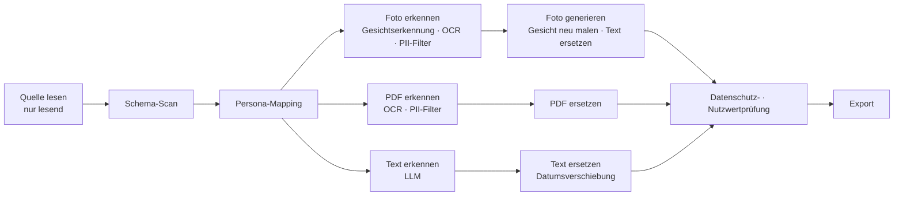

<div align="center">

[English](../../README.md) | [한국어](README.ko.md) | [简体中文](README.zh-CN.md) | [日本語](README.ja.md) | [Español](README.es.md) | [Français](README.fr.md) | **Deutsch**


# maskara

**Statt sensible Daten zu löschen, ersetzt maskara sie durch konsistente synthetische Personas – so bleiben die Daten für das KI-Training nutzbar.**

[Live-Demo](https://rl-mask.vercel.app) · [Schnellstart](#schnellstart) · [So funktioniert es](#so-funktioniert-es) · [Roadmap](#roadmap) · [Mitwirken](#mitwirken)


https://github.com/user-attachments/assets/74707848-83b9-40b7-b6c9-49ee4cb43c4d

</div>

---

## Über das Projekt

Bank- und Krankenhausdaten dürfen die Institution nicht verlassen. Und wenn sie es doch tun, ersetzt die übliche Maskierung Werte durch `[REDACTED]` und vernichtet damit genau den Kontext, aus dem ein Modell lernen soll.
maskara ersetzt nur die Werte, die eine Person identifizieren, durch eine **synthetische Persona** und lässt die analytisch relevanten Informationen unangetastet: Diagnosen, Verordnungen, die Abstände zwischen Datumsangaben und die Beziehungen zwischen Tabellen.

| | Beispiel (synthetische Daten) |
|---|---|
| Original | `Margaret Whitaker, 67F, seen 03/02/2024 with daughter Karen. MRN 004512.` |
| Herkömmliche Maskierung | `[NAME], [AGE], seen [DATE] with daughter [NAME]. MRN [ID].` |
| **maskara** | `Linda Moreno, 67F, seen 04/11/2024 with daughter Sofia. MRN 781203.` |

Ein Patient wird überall zur **selben Persona**, egal wo er auftaucht: in der Patiententabelle, in klinischen Notizen, PDF-Akten oder auf Fotos. Alle Datumsangaben eines Patienten werden um denselben Betrag verschoben, sodass die Abstände zwischen Besuchen erhalten bleiben.

## Funktionen

- **Konsistentes Persona-Mapping**: Jeder Personenschlüssel (zum Beispiel eine MRN) bekommt genau eine Persona, und diese Person wird in jeder Tabelle, jedem Dokument und jedem Bild durch dieselbe Persona ersetzt.
- **Multimodale Verarbeitung**: drei Eingabearten in einem Durchlauf.
  - Text-DB: strukturierte Spalten und Freitextnotizen
  - PDF: OCR pro Seite, danach PII-Erkennung mit dem gesamten Dokument als Kontext
  - Fotos: Gesichter werden mit dem Gesicht der Persona neu gemalt, und Text im Bild wird ebenfalls ersetzt
- **KI-Vorschläge für Spaltenregeln**: Die KI schlägt vor, wie jede Spalte behandelt werden soll (beibehalten, pseudonymisieren, Persona, Datumsverschiebung usw.), und ein Mensch bestätigt.
- **Datenschutz- und Nutzwertbericht**: Durchsucht die Ausgabe nach übrig gebliebenen Originalwerten und zeigt in Zahlen, ob Besuchsabstände, Alter, Tabellenverknüpfungen und Verteilungen erhalten geblieben sind.
- **Analyseansicht**: Führt dieselbe Abfrage (Filtern, Gruppieren, Aggregieren) auf den Original- und den maskierten Daten aus und stellt die Ergebnisse nebeneinander.
- **Mitgelieferte Beispieldaten**: Synthetische Krankenhausdaten sowie Synthea-, Nemotron-PII- und Nemotron-Personas-Beispiele lassen sich mit einem Klick laden.
- **Oberfläche auf Koreanisch / Englisch**, mit einer geführten Tour für neue Nutzer

## Schnellstart

### Voraussetzungen

- Node.js 20.9 oder neuer
- pnpm 12 (aktivieren mit `corepack enable`)
- Ein Anthropic-API-Key (für die PII-Erkennung in Freitext und die Vorschläge für Spaltenregeln)

### Installieren und starten

```bash
git clone https://github.com/return-to-the-state/RLMask.git maskara
cd maskara
pnpm install
cp .env.example .env.local   # fill in MASKING_ANTHROPIC_API_KEY
pnpm dev                     # http://localhost:3000
```

### Dein erster Maskierungslauf

1. Öffne **Datasets** in der Seitenleiste und klicke auf **Load hospital sample**.
2. Prüfe unter **New masking job** die Behandlung, die die KI für jede Spalte vorschlägt, und starte den Lauf.
3. Kontrolliere im Tab **Privacy & utility** des Laufs, dass keine personenbezogenen Daten übrig sind und die Daten weiterhin für Analysen taugen.

Beim Öffnen der App führt dich eine geführte Tour durch genau diesen Ablauf. Mit **Skip tour** kannst du sie überspringen.

## So funktioniert es

Ein Datensatz durchläuft gemeinsame Stufen, teilt sich dann in drei Spuren (Fotos, PDFs, Text) auf und wird bei der Validierung wieder zusammengeführt.



| Stufe | Modelle | Ausführung im MVP | Ausführung im Produkt (On-Prem) |
|---|---|---|---|
| Quelle lesen | — | localStorage im Browser | Kunden-DB, Connector mit Lesezugriff |
| Schema-Scan · Persona-Mapping | — | Browser | Kundennetz (Mapping-Tabelle mit dem Schlüssel des Kunden verschlüsselt) |
| Foto · PDF erkennen | YuNet, indra-ocr, OpenAI privacy-filter, Stanford de-identifier | GPU-Server des Teams | GPU-Server des Kunden |
| Foto generieren | SD 1.5 Inpainting, YuNet | GPU-Server des Teams | GPU-Server des Kunden |
| Text erkennen | Claude | Anthropic API | Lokales LLM (vLLM) |
| Ersetzen · validieren · exportieren | — | Browser | Kundennetz |

Um schnell eine Demo bereitzustellen, ersetzt der MVP vorübergehend nur zwei Bausteine: **den Datenspeicher (localStorage) und das Text-LLM (Anthropic API)**. Der Rest der Pipeline ist derselbe Code wie im Produkt. Das vollständige Design findest du in [`planning/mvp.md`](../../planning/mvp.md).

## Konfiguration

Lege Umgebungsvariablen in `.env.local` ab. Die vollständige Liste steht in [`.env.example`](../../.env.example).

| Variable | Erforderlich | Beschreibung |
|---|---|---|
| `MASKING_ANTHROPIC_API_KEY` | Ja | Anthropic-API-Key für die PII-Erkennung in Freitext und die Vorschläge für Spaltenregeln |
| `OCR_API_URL` | Nein | OCR-Server, der Text in Fotos und PDFs liest |
| `PRIVACY_FILTER_URL` | Nein | privacy-filter-Server, der PII im OCR-Text findet |
| `FACE_API_URL` | Nein | Server für die Gesichtserkennung |
| `FACE_REPAINT_URL` | Nein | Server, der Gesichter als Personas neu malt |

Lässt du eine GPU-Server-URL leer, wird der Standardserver des Teams verwendet. Ein Foto, dessen Gesicht nicht neu gemalt werden kann, wird als fehlgeschlagen markiert, statt mit dem Originalgesicht exportiert zu werden.

## Entwicklung

| Befehl | Beschreibung |
|---|---|
| `pnpm dev` | Startet den Dev-Server (synchronisiert vorher den Abschnitt „Hintergrund“ in README.ko.md) |
| `pnpm build` | Produktions-Build |
| `pnpm start` | Startet den Build |
| `pnpm lint` | Führt ESLint aus |
| `pnpm sync:readme` | Kopiert [`planning/subject.md`](../../planning/subject.md) in den Abschnitt „Hintergrund“ von [README.ko.md](README.ko.md) |

**Stack:** Next.js 16 (App Router) · React 19 · TypeScript · Tailwind CSS 4 · shadcn/ui (Radix) · Zustand · React Query · Zod · Anthropic SDK

```text
src/
├── app/            # Seiten (datasets, jobs, analysis, personas) und API-Routen
│   └── api/        # detect-pii, infer-roles, ocr, faces — alle Aufrufe externer Modelle laufen auf dem Server
├── components/     # App-UI und shadcn/ui-Komponenten
└── lib/
    ├── pipeline/   # Stufendefinitionen (stages.ts), Runner (run.ts), Foto- und PDF-Verarbeitung
    ├── pii/        # privacy-filter-Anbindung, Regeln für Formularfelder, Bewertung der Erkennungsgenauigkeit
    ├── llm/        # Claude-basierte PII-Erkennung und Klassifizierung von Spaltenrollen
    ├── face/ ocr/  # Speicher für neu gemalte Gesichter, OCR-Client
    └── i18n/       # Englische (en.ts) und koreanische (ko.ts) Texte
public/samples/     # Mitgelieferte Beispieldatensätze (alle synthetisch oder öffentlich)
planning/           # Planungsdokumente, Recherche, Folien
```

## Datenverarbeitung und Sicherheit

> [!WARNING]
> Der aktuelle MVP ist eine Demo. **Gib keine echten personenbezogenen Daten ein.**

- Freitext wird an die **Anthropic API** gesendet, Fotos und PDF-Seiten an die **GPU-Server**. Im Produkt läuft beides innerhalb des Kundennetzes.
- Datensätze, Laufergebnisse und Personas werden ausschließlich im localStorage und in der IndexedDB des Browsers gespeichert.
- Die automatische Erkennung kann nicht garantieren, dass sie alle sensiblen Daten findet. Prüfe vor dem Export immer selbst den Datenschutzbericht und die Ausgabe.

Wenn du eine Sicherheitslücke findest, eröffne bitte kein öffentliches Issue. Melde sie vertraulich über ein [GitHub Security Advisory](https://github.com/return-to-the-state/RLMask/security/advisories/new).

## Roadmap

- [x] Pipeline mit drei Spuren: Text-DB, PDF, Fotos
- [x] Konsistentes Persona-Mapping über Tabellen, Dokumente und Bilder hinweg
- [x] Datenschutz- und Nutzwertbericht sowie Analyse-Vergleichsansicht
- [ ] localStorage durch einen Connector mit Lesezugriff auf die Kunden-DB ersetzen
- [ ] Anthropic API durch ein lokales LLM (vLLM) auf den GPUs des Kunden ersetzen
- [ ] Offline-Installationspaket für abgeschottete Netze (Air-Gap)
- [ ] Verarbeitung von Audio (Gesprächsaufzeichnungen)

## Hintergrund

> Ein Service, für den US-Unternehmen im Bereich RL-Evaluierung und Trainingsdaten zahlen würden (Aufgabenstellung von AttentionX)

### In einem Satz

Ein Service, der sensible Daten durch synthetische Personas ersetzt und so personenbezogene Informationen schützt, ohne dass die Daten ihren Nutzen verlieren.

### Über den Service

Herkömmliche Datenmaskierung verbirgt oder löscht sensible Daten und kann dabei den Kontext verlieren, den eine Analyse braucht.
Dieser Service ersetzt personenbezogene Informationen wie Gesichter, Namen und Alter durch **konsistente synthetische Personas**.
Er verringert die Offenlegung des Originals und erhält zugleich die wesentlichen Merkmale und Beziehungen der Daten, sodass sie für KI-Training, Analysen und Tests genutzt werden können.

### Das Problem

- Daten von Institutionen wie Banken und Krankenhäusern **dürfen nicht nach außen gelangen.** Sie bleiben in der jeweiligen Institution eingeschlossen.
- Finanz-KI-Unternehmen brauchen diese Daten, um ihre Modelle zu trainieren, haben aber keinen Zugang dazu.
- Verkaufen Institutionen Daten, ist Maskierung Pflicht – doch herkömmliche Maskierung vernichtet den Kontext, den das Training braucht.

### Bereitstellung: On-Prem-Installation

Die Daten können nicht herauskommen, also **gehen wir dorthin, wo die Daten sind.**

1. Zugriff auf die Kunden-DB **nur lesend**.
2. De-Identifizierung innerhalb der Kundenumgebung. Das Original verlässt den Kunden nie.
3. Export ausschließlich der de-identifizierten Daten, für Training oder Verkauf.

- Läuft mit einem **lokalen LLM**. Es werden keine externen APIs aufgerufen, daher funktioniert es auch in abgeschotteten Netzen.
- Wir **verkaufen installierbare Software**, kein SaaS.
- Auf jeden Kunden zugeschnittene Installationen und laufende Updates sind nötig, daher ist **Deploy Engineering** ein Kern des Geschäfts.

### Zielkunden

- US-Unternehmen, die Trainingsdaten brauchen (Unternehmen für RL-Evaluierung und Trainingsdaten)
- Institutionen, die Daten besitzen, sie aber nicht herausgeben dürfen (Banken, Krankenhäuser)
- Finanz-KI-Unternehmen, die Modelle mit den Daten dieser Institutionen trainieren müssen

Weitere Recherchen findest du in [`planning/`](../../planning/) (auf Koreanisch): [Marktanalyse](../../planning/market.html) · [Kundenrecherche](../../planning/customers.html) · [Recherchenotizen](../../planning/research.html) · [Umsetzungsplan](../../planning/build-plan.md)

## Mitwirken

Issues und PRs sind willkommen.

1. Eröffne bei größeren Änderungen zuerst ein [Issue](https://github.com/return-to-the-state/RLMask/issues), damit wir uns über die Richtung abstimmen können.
2. Arbeite auf einem Branch und stelle sicher, dass `pnpm lint` und `pnpm build` durchlaufen, bevor du einen PR eröffnest.
3. Schreib Commit-Messages auf Englisch und im Imperativ. Beispiel: `Add date shift to the PDF lane`

Gut zu wissen:

- Füge UI-Texte **immer gemeinsam** zu `src/lib/i18n/en.ts` und `ko.ts` hinzu.
- Diese README ist die Quelle; Übersetzungen liegen in `docs/i18n/README.<lang>.md`. Wenn du sie änderst, aktualisiere auch die Übersetzungen.
- Der Abschnitt „Hintergrund“ von [README.ko.md](README.ko.md) wird aus [`planning/subject.md`](../../planning/subject.md) erzeugt. Bearbeite diese Datei, nicht die README, und aktualisiere anschließend die übersetzten Hintergrund-Abschnitte in den anderen READMEs von Hand.
- Dieses Projekt nutzt Next.js 16, dessen APIs sich von früheren Versionen unterscheiden. Lies die Anleitung in `node_modules/next/dist/docs/`, bevor du Code schreibst (siehe [`AGENTS.md`](../../AGENTS.md)).

## Danksagungen

- AttentionX — Aufgabenstellung
- [Synthea](https://github.com/synthetichealth/synthea) (Apache-2.0) — Beispiele für synthetische Patientenakten
- [NVIDIA Nemotron-PII](https://huggingface.co/datasets/nvidia/Nemotron-PII) · [Nemotron-Personas-USA](https://huggingface.co/datasets/nvidia/Nemotron-Personas-USA) (CC BY 4.0) — Dokumentbeispiele mit PII-Lösungsschlüsseln sowie Persona-Beispiele

## Lizenz

Bisher wurde keine Open-Source-Lizenz gewählt. Solange keine `LICENSE`-Datei hinzugefügt wurde, darf der Code in diesem Repository ohne Erlaubnis des Urheberrechtsinhabers weder verwendet noch verändert oder verbreitet werden.
