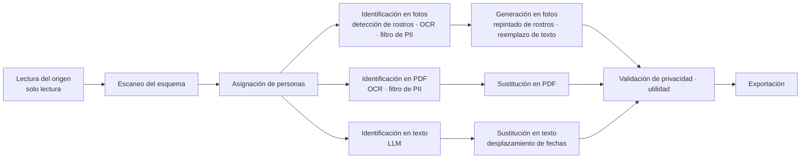

<div align="center">

[English](../../README.md) | [한국어](README.ko.md) | [简体中文](README.zh-CN.md) | [日本語](README.ja.md) | **Español** | [Français](README.fr.md) | [Deutsch](README.de.md)


# maskara

**En lugar de borrar los datos sensibles, maskara los sustituye por personas sintéticas coherentes, para que los datos sigan sirviendo para entrenar IA.**

[Demo en vivo](https://rl-mask.vercel.app) · [Inicio rápido](#inicio-rápido) · [Cómo funciona](#cómo-funciona) · [Hoja de ruta](#hoja-de-ruta) · [Contribuir](#contribuir)


https://github.com/user-attachments/assets/9f8c173c-8290-444c-8a75-a590fc4b9fdb

</div>

---

## Acerca de

Los datos de bancos y hospitales no pueden salir de la institución, y cuando salen, el enmascaramiento que se aplica reemplaza los valores por `[REDACTED]` y elimina el contexto del que un modelo necesita aprender.
maskara reemplaza por una **persona sintética** solo los valores que identifican a alguien y deja intacta la información analítica: diagnósticos, recetas, los intervalos entre fechas y las relaciones entre tablas.

| | Ejemplo (datos sintéticos) |
|---|---|
| Original | `Margaret Whitaker, 67F, seen 03/02/2024 with daughter Karen. MRN 004512.` |
| Enmascaramiento convencional | `[NAME], [AGE], seen [DATE] with daughter [NAME]. MRN [ID].` |
| **maskara** | `Linda Moreno, 67F, seen 04/11/2024 with daughter Sofia. MRN 781203.` |

Un paciente se convierte en **la misma persona** dondequiera que aparezca: la tabla de pacientes, las notas clínicas, los registros en PDF o las fotos. Las fechas de cada paciente se desplazan en la misma cantidad, así que los intervalos entre visitas se conservan.

## Características

- **Asignación coherente de personas**: cada clave de persona (un MRN, por ejemplo) recibe una sola persona, y esa persona real se reemplaza por la misma persona sintética en todas las tablas, documentos e imágenes.
- **Procesamiento multimodal**: tres tipos de entrada en una sola ejecución.
  - BD de texto: columnas estructuradas y notas en texto libre
  - PDF: OCR por página y luego detección de PII usando todo el documento como contexto
  - Fotos: los rostros se repintan con el rostro de la persona, y el texto dentro de la imagen también se reemplaza
- **Sugerencias de política por columna con IA**: la IA sugiere cómo tratar cada columna (conservar, seudonimizar, persona, desplazamiento de fechas, etc.) y una persona lo confirma.
- **Informe de privacidad y utilidad**: busca en la salida cualquier valor original que haya quedado y muestra con números si se conservaron los intervalos entre visitas, las edades, los vínculos entre tablas y las distribuciones.
- **Pantalla de análisis**: ejecuta la misma consulta (filtrar, agrupar, agregar) sobre los datos originales y los enmascarados, y compara los resultados lado a lado.
- **Datos de muestra integrados**: carga con un clic muestras de datos hospitalarios sintéticos, Synthea, Nemotron-PII y Nemotron-Personas.
- **Interfaz en coreano / inglés**, con un recorrido guiado para quienes la usan por primera vez

## Inicio rápido

### Requisitos

- Node.js 20.9 o posterior
- pnpm 12 (actívalo con `corepack enable`)
- Una clave de API de Anthropic (se usa para detectar PII en texto libre y sugerir políticas por columna)

### Instalación y ejecución

```bash
git clone https://github.com/return-to-the-state/RLMask.git maskara
cd maskara
pnpm install
cp .env.example .env.local   # fill in MASKING_ANTHROPIC_API_KEY
pnpm dev                     # http://localhost:3000
```

### Tu primer enmascaramiento

1. Abre **Datasets** en la barra lateral y haz clic en **Load hospital sample**.
2. En **New masking job**, revisa el tratamiento que la IA sugirió para cada columna y ejecútalo.
3. En la pestaña **Privacy & utility** de la ejecución, comprueba que no quedan datos personales y que los datos siguen siendo útiles para el análisis.

Al abrir la app, un recorrido guiado te lleva por este mismo flujo. Haz clic en **Skip tour** para omitirlo.

## Cómo funciona

Un conjunto de datos pasa por etapas comunes, se divide en tres carriles (fotos, PDF, texto) y vuelve a unirse en la validación.



| Etapa | Modelos | Dónde se ejecuta en el MVP | Dónde se ejecuta en el producto (on-premise) |
|---|---|---|---|
| Lectura del origen | — | localStorage del navegador | BD del cliente, conector de solo lectura |
| Escaneo del esquema · asignación de personas | — | Navegador | Red del cliente (tabla de asignación cifrada con la clave del cliente) |
| Identificación en fotos · PDF | YuNet, indra-ocr, OpenAI privacy-filter, Stanford de-identifier | Servidor GPU del equipo | Servidor GPU del cliente |
| Generación en fotos | SD 1.5 Inpainting, YuNet | Servidor GPU del equipo | Servidor GPU del cliente |
| Identificación en texto | Claude | API de Anthropic | LLM local (vLLM) |
| Sustitución · validación · exportación | — | Navegador | Red del cliente |

Para sacar una demo rápido, el MVP sustituye temporalmente solo dos piezas: **el almacén de datos (localStorage) y el LLM de texto (API de Anthropic)**. El resto del pipeline es el mismo código que el producto. Consulta [`planning/mvp.md`](../../planning/mvp.md) para ver el diseño completo.

## Configuración

Define las variables de entorno en `.env.local`. La lista completa está en [`.env.example`](../../.env.example).

| Variable | Obligatoria | Descripción |
|---|---|---|
| `MASKING_ANTHROPIC_API_KEY` | Sí | Clave de API de Anthropic para detectar PII en texto libre y sugerir políticas por columna |
| `OCR_API_URL` | No | Servidor de OCR que lee el texto de fotos y PDF |
| `PRIVACY_FILTER_URL` | No | Servidor de privacy-filter que encuentra PII en el texto del OCR |
| `FACE_API_URL` | No | Servidor de detección de rostros |
| `FACE_REPAINT_URL` | No | Servidor que repinta los rostros como personas |

Deja vacía la URL de un servidor GPU para usar el servidor predeterminado del equipo. Una foto cuyo rostro no se pueda repintar se marca como fallida en lugar de exportarse con el rostro original.

## Desarrollo

| Comando | Descripción |
|---|---|
| `pnpm dev` | Inicia el servidor de desarrollo (antes sincroniza la sección de contexto de README.ko.md) |
| `pnpm build` | Build de producción |
| `pnpm start` | Ejecuta el build |
| `pnpm lint` | Ejecuta ESLint |
| `pnpm sync:readme` | Copia [`planning/subject.md`](../../planning/subject.md) en la sección de contexto de [README.ko.md](README.ko.md) |

**Stack:** Next.js 16 (App Router) · React 19 · TypeScript · Tailwind CSS 4 · shadcn/ui (Radix) · Zustand · React Query · Zod · Anthropic SDK

```text
src/
├── app/            # Páginas (datasets, jobs, analysis, personas) y rutas de API
│   └── api/        # detect-pii, infer-roles, ocr, faces — todas las llamadas a modelos externos ocurren en el servidor
├── components/     # UI de la app y componentes de shadcn/ui
└── lib/
    ├── pipeline/   # Definición de etapas (stages.ts), ejecutor (run.ts), procesamiento de fotos y PDF
    ├── pii/        # Integración con privacy-filter, reglas de campos de formulario, evaluación de la precisión de detección
    ├── llm/        # Detección de PII y clasificación de roles de columna con Claude
    ├── face/ ocr/  # Almacén de rostros repintados, cliente de OCR
    └── i18n/       # Textos en inglés (en.ts) y coreano (ko.ts)
public/samples/     # Conjuntos de datos de muestra integrados (todos sintéticos o públicos)
planning/           # Documentos de planificación, investigación, diapositivas
```

## Manejo de datos y seguridad

> [!WARNING]
> El MVP actual es una demo. **No introduzcas datos personales reales.**

- El texto libre se envía a la **API de Anthropic**, y las fotos y páginas de PDF a los **servidores GPU**. En el producto, ambos se ejecutan dentro de la red del cliente.
- Los conjuntos de datos, los resultados de las ejecuciones y las personas se guardan solo en el localStorage y el IndexedDB del navegador.
- No se puede garantizar que la detección automática encuentre todos los datos sensibles. Revisa siempre tú mismo el informe de privacidad y la salida antes de exportar.

Si encuentras una vulnerabilidad de seguridad, no abras un issue público. Infórmala de forma privada mediante un [GitHub Security Advisory](https://github.com/return-to-the-state/RLMask/security/advisories/new).

## Hoja de ruta

- [x] Pipeline de tres carriles: BD de texto, PDF, fotos
- [x] Asignación coherente de personas entre tablas, documentos e imágenes
- [x] Informe de privacidad y utilidad, y pantalla de comparación de análisis
- [ ] Reemplazar localStorage por un conector de solo lectura a la BD del cliente
- [ ] Reemplazar la API de Anthropic por un LLM local (vLLM) en las GPU del cliente
- [ ] Paquete de instalación offline para redes aisladas (air-gapped)
- [ ] Procesamiento de audio (grabaciones de llamadas)

## Contexto

> Un servicio por el que pagarían las empresas estadounidenses de evaluación RL y de datos (problema planteado por AttentionX)

### En una línea

Un servicio que reemplaza los datos sensibles por personas sintéticas, protegiendo la información personal sin que los datos pierdan su utilidad.

### Sobre el servicio

El enmascaramiento de datos convencional oculta o elimina los datos sensibles, y en el proceso puede perder el contexto que necesita el análisis.
Este servicio reemplaza información personal como rostros, nombres y edades por **personas sintéticas coherentes**.
Reduce la exposición del original y conserva las características y relaciones clave de los datos, para que puedan usarse en entrenamiento de IA, análisis y pruebas.

### El problema

- Los datos que tienen instituciones como bancos y hospitales **no pueden sacarse fuera.** Quedan encerrados dentro de cada institución.
- Las empresas de IA financiera necesitan estos datos para entrenar sus modelos, pero no tienen forma de conseguirlos.
- El enmascaramiento es obligatorio cuando las instituciones venden datos, pero el enmascaramiento convencional elimina el contexto que necesita el entrenamiento.

### Entrega: instalación on-premise

Los datos no pueden salir, así que **vamos a donde están los datos.**

1. Acceder a la BD del cliente en **solo lectura**.
2. Desidentificar dentro del entorno del cliente. El original nunca sale del cliente.
3. Exportar solo los datos desidentificados, para entrenamiento o venta.

- Funciona con un **LLM local**. No llama a ninguna API externa, así que funciona en redes aisladas.
- **Vendemos software instalable**, no SaaS.
- Hacen falta instalaciones adaptadas al entorno de cada cliente y actualizaciones continuas, así que la **ingeniería de despliegue** es clave para el negocio.

### Clientes objetivo

- Empresas estadounidenses que necesitan datos de entrenamiento (empresas de evaluación RL y de datos)
- Instituciones que tienen datos pero no pueden exportarlos (bancos, hospitales)
- Empresas de IA financiera que necesitan entrenar modelos con los datos de estas instituciones

Hay más investigación en [`planning/`](../../planning/) (en coreano): [análisis de mercado](../../planning/market.html) · [investigación de clientes](../../planning/customers.html) · [notas de investigación](../../planning/research.html) · [plan de desarrollo](../../planning/build-plan.md)

## Contribuir

Los issues y PR son bienvenidos.

1. Para cambios grandes, abre primero un [issue](https://github.com/return-to-the-state/RLMask/issues) para que acordemos la dirección.
2. Trabaja en una rama y asegúrate de que `pnpm lint` y `pnpm build` pasen antes de abrir un PR.
3. Escribe los mensajes de commit en inglés y en modo imperativo. Ejemplo: `Add date shift to the PDF lane`

Conviene saber:

- Añade los textos de la UI a `src/lib/i18n/en.ts` y `ko.ts` **a la vez**.
- Este README es la fuente; las traducciones están en `docs/i18n/README.<lang>.md`. Cuando lo cambies, actualiza también las traducciones.
- La sección de contexto de [README.ko.md](README.ko.md) se genera a partir de [`planning/subject.md`](../../planning/subject.md). Edita ese archivo, no el README, y luego actualiza a mano las secciones de contexto traducidas en los demás README.
- Este proyecto usa Next.js 16, cuyas API difieren de las versiones anteriores. Lee la guía en `node_modules/next/dist/docs/` antes de escribir código (consulta [`AGENTS.md`](../../AGENTS.md)).

## Agradecimientos

- AttentionX — planteamiento del problema
- [Synthea](https://github.com/synthetichealth/synthea) (Apache-2.0) — muestras de historiales de pacientes sintéticos
- [NVIDIA Nemotron-PII](https://huggingface.co/datasets/nvidia/Nemotron-PII) · [Nemotron-Personas-USA](https://huggingface.co/datasets/nvidia/Nemotron-Personas-USA) (CC BY 4.0) — muestras de documentos con claves de respuesta de PII y muestras de personas

## Licencia

Todavía no se ha elegido una licencia de código abierto. Hasta que se añada un archivo `LICENSE`, el código de este repositorio no puede usarse, modificarse ni distribuirse sin el permiso del titular de los derechos de autor.
