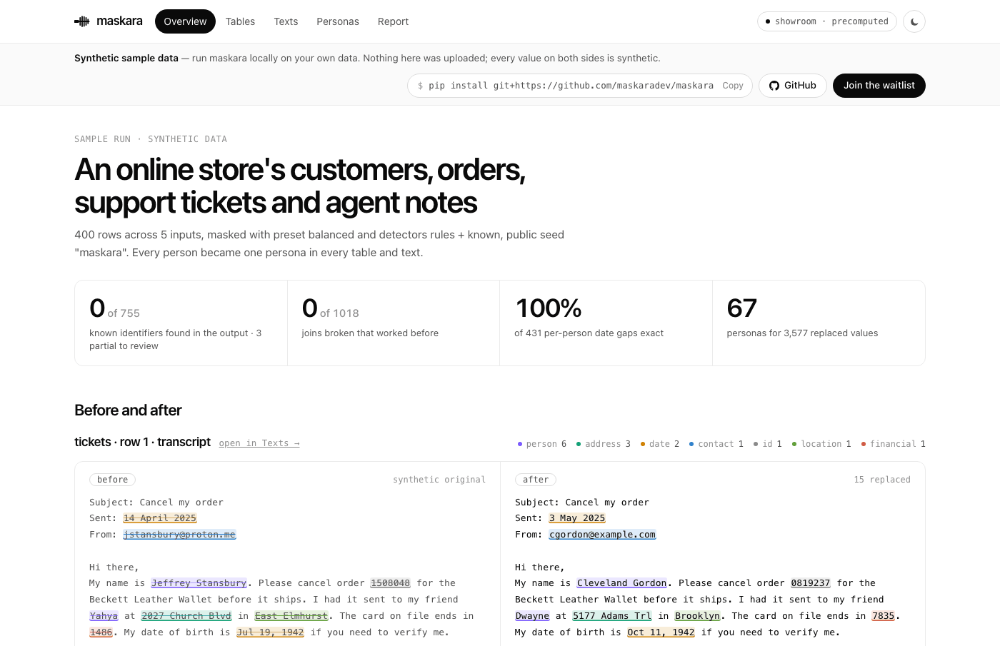

# maskara


<p align="center">
  
</p>

<p align="center">
  <a href="https://maskara.dev">maskara.dev</a> · <a href="https://app.maskara.dev">demo</a> · <a href="#inicio-rápido">inicio rápido</a> · <a href="../../intents.md">intención</a>
</p>

<p align="center">
  <a href="../../README.md">English</a> · <a href="README.ko.md">한국어</a> · <a href="README.zh-CN.md">简体中文</a> · <a href="README.ja.md">日本語</a> · Español · <a href="README.fr.md">Français</a> · <a href="README.de.md">Deutsch</a>
</p>

<p align="center">
  <a href="../../LICENSE"></a>
  
  <a href="https://github.com/maskaradev/maskara/stargazers"></a>
</p>

---

**cambia los datos personales por personas sintéticas consistentes en lugar de tacharlos, y demuestra que los datos siguen siendo útiles y no se filtraron.**

<p align="center">
  <a href="https://app.maskara.dev"></a>
</p>

- **sustituir, no tachar** — nombres, correos, teléfonos, direcciones, fechas e ids pasan a ser los de una persona sintética, no `[REDACTED]`. el resto del texto queda igual.
- **una persona, una persona sintética** — un cliente es la misma persona sintética en cada tabla y en cada texto que lo menciona, y con un vault, también en la siguiente ejecución.
- **las fechas se mueven juntas** — todas las fechas de una persona se desplazan lo mismo, así que los intervalos entre ellas se mantienen exactos.
- **los joins siguen funcionando** — un id recibe el mismo reemplazo en todas las tablas y textos, y conserva su prefijo de letras (`CUS-575198` → `CUS-224730`).
- **presets** — `strict`, `balanced` (por defecto) o `max_utility`: cuánto se parece la persona sintética a la original en edad, región y perfil.
- **vault local, sin originales** — `.maskara/vault.db` mantiene las personas sintéticas estables entre ejecuciones. guarda hashes con clave y valores sintéticos, nunca un original.
- **detección** — reglas para correos, teléfonos, tarjetas, ids y fechas, más cada valor que las tablas ya conocen. añade el modelo de pii gliner2 con `maskara-ai[gliner]`, y paquetes de patrones opcionales para ids de un dominio (`legal-echr`).
- **un informe en cada ejecución** — originales que quedaron en la salida, joins rotos, intervalos entre fechas, formatos que siguen siendo válidos, k-anonimato de lo que se conservó y un ataque de enlace sobre ello. además, una lista de lo que no pudo medir.
- **`maskara ui`** — un visor local de ejecuciones, con el antes y el después lado a lado, que solo escucha en 127.0.0.1.
- **pequeño y sin conexión** — el núcleo usa solo la biblioteca estándar de python y no necesita red.

## inicio rápido

```bash
pip install git+https://github.com/maskaradev/maskara   # python 3.11+
maskara demo        # mask the bundled sample store and print the report
maskara ui --demo   # see it side by side in the browser
```

cuando esté publicado en pypi será `pip install maskara-ai`. el paquete `maskara` de pypi es otro proyecto. para el modelo gliner2:

```bash
pip install "maskara-ai[gliner] @ git+https://github.com/maskaradev/maskara"
```

### python

```python
import maskara

result = maskara.mask(
    tables={
        "customers": [
            {"customer_id": "C-1001", "name": "Maria Lopez", "email": "maria.lopez@gmail.com", "birth_date": "1984-03-02"},
        ],
        "orders": [
            {"order_id": "ORD-55012", "customer_id": "C-1001", "ordered_on": "2025-04-14"},
            {"order_id": "ORD-55019", "customer_id": "C-1001", "ordered_on": "2025-04-20"},
        ],
    },
    texts={"notes": ["Maria Lopez called on April 21, 2025 about order ORD-55019. Reach her at maria.lopez@gmail.com."]},
    subjects={"customers": "customer_id", "orders": "customer_id"},
    vault=".maskara/vault.db",  # same person, same persona on the next run
)
print(result.texts["notes"])
# ['Kara Brown called on May 9, 2025 about order ORD-10991. Reach her at kara.brown@example.org.']
print(result.report.summary())
```

las tablas pueden ser listas de dicts, rutas csv o jsonl, o dataframes de pandas; recibes de vuelta el mismo tipo. los textos pueden ser listas de cadenas, rutas `.txt` o `.jsonl`, o una series de pandas. tus personas sintéticas serán distintas de las de arriba: salen de la clave de tu vault.

### cli

```bash
maskara mask --table customers=customers.csv --table orders=orders.csv --text tickets=tickets.jsonl \
  --subject customers=customer_id --subject orders=customer_id --subject tickets=customer_id \
  --out masked/
```

`masked/` recibe cada entrada con el mismo nombre, `report.json`, `report.html` y `mentions.jsonl` (qué se reemplazó y dónde, sin los originales). `maskara report masked/` vuelve a mostrar el informe, y `maskara mask --help` lista el resto (`--preset`, `--detector`, `--pattern`, una configuración toml).

## benchmarks

`maskara bench` puntúa a maskara y a las alternativas (redaction, presidio, gliner2, openai privacy filter) con un mismo evaluador, por lo que se filtró y lo que siguió siendo útil, en cuatro corpus: [TAB](https://github.com/NorskRegnesentral/text-anonymization-benchmark) (sentencias reales), [ABCD](https://github.com/asappresearch/abcd) (chats de soporte escritos por personas), [Nemotron-PII](https://huggingface.co/datasets/nvidia/Nemotron-PII) (sintético) y `linked` (tablas y textos enlazados que generamos nosotros, así que se sabe quién es quién). las cifras públicas saldrán de los tres primeros; `linked` se reporta aparte, porque lo construimos nosotros. el diseño y su registro de decisiones están en [`docs/research/v0-design.md`](../research/v0-design.md) (en coreano).

esto es v0, y solo en inglés. las personas sintéticas salen de [NVIDIA Nemotron-Personas-USA](https://huggingface.co/datasets/nvidia/Nemotron-Personas-USA) (CC BY 4.0) y los nombres de pila de los [nombres de bebés de la SSA](https://www.ssa.gov/oact/babynames/limits.html), así que son estadounidenses.

## seguridad

maskara se ejecuta en tu máquina y no envía nada a ningún sitio. la red solo se usa si tú lo eliges: un modelo opcional se descarga una vez en el primer uso, `maskara bench` descarga sus corpus y `bench --qa llm` llama al endpoint de modelo que configures. v0 no ha sido auditado, así que revisa el informe antes de compartir una salida. reporta problemas de seguridad mediante un [aviso privado](https://github.com/maskaradev/maskara/security/advisories/new).

## agradecimientos

a [NVIDIA Nemotron-PII](https://huggingface.co/datasets/nvidia/Nemotron-PII), [Nemotron-Personas-USA](https://huggingface.co/datasets/nvidia/Nemotron-Personas-USA) y los [nombres de bebés de la SSA](https://www.ssa.gov/oact/babynames/limits.html) por las personas sintéticas y los datos de ejemplo, y a [TAB](https://github.com/NorskRegnesentral/text-anonymization-benchmark) y [ABCD](https://github.com/asappresearch/abcd) por los benchmarks

## desarrollo

```bash
uv sync --all-extras --all-groups
uv run pytest
uv run ruff check src tests
```

la página de inicio y la demo alojada viven en `web/` (node 20.9+, pnpm 12):

```bash
cd web
pnpm install
pnpm dev      # dev server: localhost:3000, and the demo at app.localhost:3000
pnpm lint     # eslint
pnpm build    # production build
```

`maskara ui --export web/public/demo` regenera la demo alojada. si eres un agente de ia trabajando en `web/`, lee primero [`web/AGENTS.md`](../../web/AGENTS.md). las traducciones parten del [README](../../README.md) en inglés.

## licencia

maskara se distribuye bajo la [Apache License 2.0](../../LICENSE). los datos de personas sintéticas y de ejemplo incluidos derivan de fuentes CC BY 4.0 y de dominio público; consulta [`src/maskara/data/NOTICE`](../../src/maskara/data/NOTICE).
