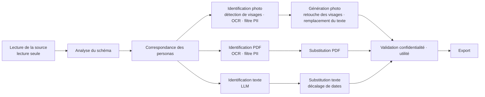

<div align="center">

[English](../../README.md) | [한국어](README.ko.md) | [简体中文](README.zh-CN.md) | [日本語](README.ja.md) | [Español](README.es.md) | **Français** | [Deutsch](README.de.md)


# maskara

**Au lieu d'effacer les données sensibles, maskara les remplace par des personas synthétiques cohérents, pour que les données restent exploitables pour l'entraînement d'IA.**

[Démo en ligne](https://rl-mask.vercel.app) · [Démarrage rapide](#démarrage-rapide) · [Fonctionnement](#fonctionnement) · [Feuille de route](#feuille-de-route) · [Contribuer](#contribuer)


https://github.com/user-attachments/assets/74707848-83b9-40b7-b6c9-49ee4cb43c4d

</div>

---

## À propos

Les données des banques et des hôpitaux ne peuvent pas sortir de l'établissement, et quand elles sortent, le masquage utilisé remplace les valeurs par `[REDACTED]`, ce qui détruit le contexte dont un modèle a besoin pour apprendre.
maskara ne remplace que les valeurs qui identifient une personne par un **persona synthétique** et laisse intactes les informations utiles à l'analyse : diagnostics, prescriptions, écarts entre les dates et relations entre les tables.

| | Exemple (données synthétiques) |
|---|---|
| Original | `Margaret Whitaker, 67F, seen 03/02/2024 with daughter Karen. MRN 004512.` |
| Masquage classique | `[NAME], [AGE], seen [DATE] with daughter [NAME]. MRN [ID].` |
| **maskara** | `Linda Moreno, 67F, seen 04/11/2024 with daughter Sofia. MRN 781203.` |

Un patient devient **le même persona** partout où il apparaît : table des patients, notes cliniques, dossiers PDF ou photos. Toutes les dates d'un même patient sont décalées de la même durée, ce qui préserve les intervalles entre les visites.

## Fonctionnalités

- **Correspondance cohérente des personas** : chaque clé de personne (un MRN, par exemple) reçoit un seul persona, et cette personne est remplacée par ce même persona dans chaque table, document et image.
- **Traitement multimodal** : trois types d'entrée en une seule exécution.
  - Base de données texte : colonnes structurées et notes en texte libre
  - PDF : OCR page par page, puis détection des PII avec le document entier comme contexte
  - Photos : les visages sont redessinés avec celui du persona, et le texte présent dans l'image est aussi remplacé
- **Suggestions de politique par colonne par l'IA** : l'IA propose un traitement pour chaque colonne (conserver, pseudonymiser, persona, décalage de date, etc.), et une personne valide.
- **Rapport de confidentialité et d'utilité** : recherche dans la sortie toute valeur d'origine restante, et montre chiffres à l'appui si les écarts entre visites, les âges, les liens entre tables et les distributions ont été préservés.
- **Écran d'analyse** : exécute la même requête (filtre, regroupement, agrégation) sur les données d'origine et sur les données masquées, et compare les résultats côte à côte.
- **Données d'exemple intégrées** : chargez en un clic des données hospitalières synthétiques et des échantillons Synthea, Nemotron-PII et Nemotron-Personas.
- **Interface en coréen et en anglais**, avec une visite guidée pour les nouveaux utilisateurs

## Démarrage rapide

### Prérequis

- Node.js 20.9 ou version ultérieure
- pnpm 12 (activez-le avec `corepack enable`)
- Une clé API Anthropic (utilisée pour la détection des PII dans le texte libre et les suggestions de politique par colonne)

### Installation et lancement

```bash
git clone https://github.com/return-to-the-state/RLMask.git maskara
cd maskara
pnpm install
cp .env.example .env.local   # fill in MASKING_ANTHROPIC_API_KEY
pnpm dev                     # http://localhost:3000
```

### Votre premier masquage

1. Ouvrez **Datasets** dans la barre latérale et cliquez sur **Load hospital sample**.
2. Dans **New masking job**, vérifiez le traitement suggéré par l'IA pour chaque colonne, puis lancez l'exécution.
3. Dans l'onglet **Privacy & utility** de l'exécution, vérifiez qu'il ne reste aucune donnée personnelle et que les données sont toujours utiles pour l'analyse.

À l'ouverture de l'application, une visite guidée vous fait parcourir ce même déroulé. Cliquez sur **Skip tour** pour la passer.

## Fonctionnement

Un jeu de données passe par des étapes communes, se divise en trois voies (photos, PDF, texte), puis les voies se rejoignent à la validation.



| Étape | Modèles | Où elle s'exécute dans le MVP | Où elle s'exécute dans le produit (sur site) |
|---|---|---|---|
| Lecture de la source | — | localStorage du navigateur | Base de données du client, connecteur en lecture seule |
| Analyse du schéma · correspondance des personas | — | Navigateur | Réseau du client (table de correspondance chiffrée avec la clé du client) |
| Identification photo · PDF | YuNet, indra-ocr, OpenAI privacy-filter, Stanford de-identifier | Serveur GPU de l'équipe | Serveur GPU du client |
| Génération photo | SD 1.5 Inpainting, YuNet | Serveur GPU de l'équipe | Serveur GPU du client |
| Identification texte | Claude | API Anthropic | LLM local (vLLM) |
| Substitution · validation · export | — | Navigateur | Réseau du client |

Pour sortir une démo rapidement, le MVP remplace temporairement deux éléments seulement : **le stockage des données (localStorage) et le LLM texte (API Anthropic)**. Le reste du pipeline est le même code que celui du produit. Consultez [`planning/mvp.md`](../../planning/mvp.md) pour la conception complète.

## Configuration

Placez les variables d'environnement dans `.env.local`. La liste complète se trouve dans [`.env.example`](../../.env.example).

| Variable | Obligatoire | Description |
|---|---|---|
| `MASKING_ANTHROPIC_API_KEY` | Oui | Clé API Anthropic pour la détection des PII dans le texte libre et les suggestions de politique par colonne |
| `OCR_API_URL` | Non | Serveur OCR qui lit le texte des photos et des PDF |
| `PRIVACY_FILTER_URL` | Non | Serveur privacy-filter qui repère les PII dans le texte issu de l'OCR |
| `FACE_API_URL` | Non | Serveur de détection de visages |
| `FACE_REPAINT_URL` | Non | Serveur qui redessine les visages en personas |

Laissez vide l'URL d'un serveur GPU pour utiliser le serveur par défaut de l'équipe. Une photo dont le visage ne peut pas être redessiné est marquée en échec au lieu d'être exportée avec le visage d'origine.

## Développement

| Commande | Description |
|---|---|
| `pnpm dev` | Démarre le serveur de développement (synchronise d'abord la section Contexte de README.ko.md) |
| `pnpm build` | Build de production |
| `pnpm start` | Lance le build |
| `pnpm lint` | Exécute ESLint |
| `pnpm sync:readme` | Copie [`planning/subject.md`](../../planning/subject.md) dans la section Contexte de [README.ko.md](README.ko.md) |

**Stack :** Next.js 16 (App Router) · React 19 · TypeScript · Tailwind CSS 4 · shadcn/ui (Radix) · Zustand · React Query · Zod · Anthropic SDK

```text
src/
├── app/            # Pages (datasets, jobs, analysis, personas) and API routes
│   └── api/        # detect-pii, infer-roles, ocr, faces — all external model calls happen on the server
├── components/     # App UI and shadcn/ui components
└── lib/
    ├── pipeline/   # Stage definitions (stages.ts), runner (run.ts), photo and PDF processing
    ├── pii/        # privacy-filter integration, form-field rules, detection accuracy evaluation
    ├── llm/        # Claude-based PII detection and column role classification
    ├── face/ ocr/  # Face repaint store, OCR client
    └── i18n/       # English (en.ts) and Korean (ko.ts) strings
public/samples/     # Built-in sample datasets (all synthetic or public)
planning/           # Planning docs, research, slides
```

## Traitement des données et sécurité

> [!WARNING]
> Le MVP actuel est une démo. **N'y mettez pas de vraies données personnelles.**

- Le texte libre est envoyé à l'**API Anthropic**, et les photos et pages PDF aux **serveurs GPU**. Dans le produit, les deux s'exécutent à l'intérieur du réseau du client.
- Les jeux de données, les résultats d'exécution et les personas sont stockés uniquement dans le localStorage et l'IndexedDB du navigateur.
- La détection automatique ne peut pas garantir de trouver toutes les données sensibles. Vérifiez toujours vous-même le rapport de confidentialité et la sortie avant d'exporter.

Si vous découvrez une faille de sécurité, n'ouvrez pas d'issue publique. Signalez-la en privé via une [GitHub Security Advisory](https://github.com/return-to-the-state/RLMask/security/advisories/new).

## Feuille de route

- [x] Pipeline à trois voies : base de données texte, PDF, photos
- [x] Correspondance cohérente des personas entre tables, documents et images
- [x] Rapport de confidentialité et d'utilité, et écran de comparaison pour l'analyse
- [ ] Remplacer localStorage par un connecteur en lecture seule vers la base de données du client
- [ ] Remplacer l'API Anthropic par un LLM local (vLLM) sur les GPU du client
- [ ] Bundle d'installation hors ligne pour les réseaux isolés
- [ ] Traitement audio (enregistrements d'appels)

## Contexte

> Un service pour lequel les entreprises américaines d'évaluation RL et de données seraient prêtes à payer (sujet proposé par AttentionX)

### En une phrase

Un service qui remplace les données sensibles par des personas synthétiques, protégeant ainsi les informations personnelles tout en gardant les données utiles.

### Le service

Le masquage de données classique masque ou supprime les données sensibles, et peut au passage perdre le contexte nécessaire à l'analyse.
Ce service remplace les informations personnelles comme les visages, les noms et les âges par des **personas synthétiques cohérents**.
Il réduit l'exposition des données d'origine tout en préservant leurs caractéristiques et relations essentielles, pour qu'elles puissent servir à l'entraînement d'IA, à l'analyse et aux tests.

### Le problème

- Les données détenues par des établissements comme les banques et les hôpitaux **ne peuvent pas sortir.** Elles restent enfermées dans chaque établissement.
- Les entreprises d'IA financière ont besoin de ces données pour entraîner leurs modèles, mais n'ont aucun moyen d'y accéder.
- Le masquage est obligatoire lorsque les établissements vendent des données, mais le masquage classique détruit le contexte dont l'entraînement a besoin.

### Mode de livraison : installation sur site

Les données ne peuvent pas sortir, alors **c'est nous qui allons là où sont les données.**

1. Accès à la base de données du client **en lecture seule**.
2. Désidentification dans l'environnement du client. Les données d'origine ne quittent jamais le client.
3. Export des seules données désidentifiées, pour l'entraînement ou la vente.

- Fonctionne avec un **LLM local**. Aucune API externe n'est appelée, ce qui permet de fonctionner sur des réseaux isolés.
- Nous **vendons un logiciel à installer**, pas un SaaS.
- Chaque client exige une installation adaptée à son environnement et des mises à jour continues : le **deploy engineering** est donc au cœur de l'activité.

### Clients cibles

- Les entreprises américaines qui ont besoin de données d'entraînement (entreprises d'évaluation RL et de données)
- Les établissements qui détiennent des données sans pouvoir les exporter (banques, hôpitaux)
- Les entreprises d'IA financière qui doivent entraîner des modèles sur les données de ces établissements

D'autres recherches se trouvent dans [`planning/`](../../planning/) (en coréen) : [analyse de marché](../../planning/market.html) · [étude clients](../../planning/customers.html) · [notes de recherche](../../planning/research.html) · [plan de développement](../../planning/build-plan.md)

## Contribuer

Les issues et les PR sont les bienvenues.

1. Pour les changements importants, ouvrez d'abord une [issue](https://github.com/return-to-the-state/RLMask/issues) afin que nous puissions nous accorder sur la direction.
2. Travaillez sur une branche, et assurez-vous que `pnpm lint` et `pnpm build` passent avant d'ouvrir une PR.
3. Rédigez les messages de commit en anglais, à l'impératif. Exemple : `Add date shift to the PDF lane`

Bon à savoir :

- Ajoutez les chaînes d'interface dans `src/lib/i18n/en.ts` et `ko.ts` **en même temps**.
- Ce README est la source ; les traductions se trouvent dans `docs/i18n/README.<lang>.md`. Quand vous le modifiez, mettez aussi à jour les traductions.
- La section Contexte de [README.ko.md](README.ko.md) est générée à partir de [`planning/subject.md`](../../planning/subject.md). Modifiez ce fichier, pas le README, puis mettez à jour à la main les sections Contexte traduites des autres README.
- Ce projet utilise Next.js 16, dont les API diffèrent des versions précédentes. Lisez le guide dans `node_modules/next/dist/docs/` avant d'écrire du code (voir [`AGENTS.md`](../../AGENTS.md)).

## Remerciements

- AttentionX — sujet proposé
- [Synthea](https://github.com/synthetichealth/synthea) (Apache-2.0) — échantillons de dossiers patients synthétiques
- [NVIDIA Nemotron-PII](https://huggingface.co/datasets/nvidia/Nemotron-PII) · [Nemotron-Personas-USA](https://huggingface.co/datasets/nvidia/Nemotron-Personas-USA) (CC BY 4.0) — échantillons de documents avec annotations de référence des PII, et échantillons de personas

## Licence

Aucune licence open source n'a encore été choisie. Tant qu'aucun fichier `LICENSE` n'a été ajouté, le code de ce dépôt ne peut être ni utilisé, ni modifié, ni distribué sans l'autorisation du titulaire des droits d'auteur.
