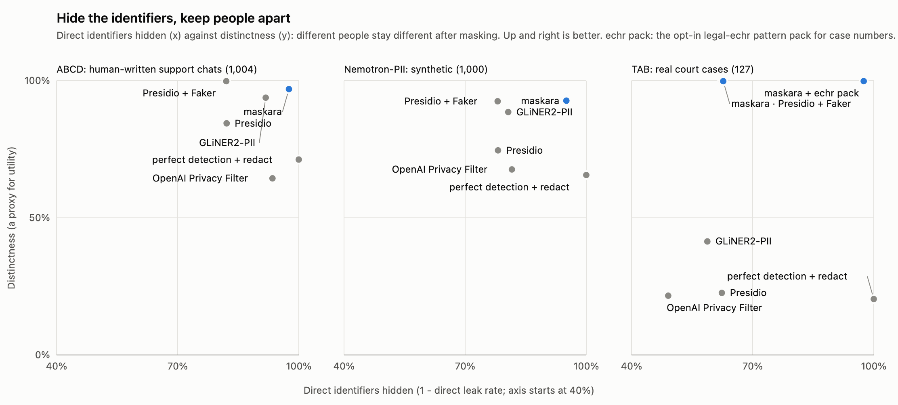

# maskara


<p align="center">
  
</p>

<p align="center">
  <a href="https://maskara.dev">maskara.dev</a> · <a href="https://app.maskara.dev">démo</a> · <a href="#démarrage-rapide">démarrage rapide</a> · <a href="../../intents.md">intentions</a>
</p>

<p align="center">
  <a href="../../README.md">English</a> · <a href="README.ko.md">한국어</a> · <a href="README.zh-CN.md">简体中文</a> · <a href="README.ja.md">日本語</a> · <a href="README.es.md">Español</a> · Français · <a href="README.de.md">Deutsch</a>
</p>

<p align="center">
  <a href="../../LICENSE"></a>
  
  <a href="https://github.com/maskaradev/maskara/stargazers"></a>
</p>

---

**remplacez les données personnelles par des personas synthétiques cohérents au lieu de les caviarder, puis prouvez que les données restent utiles et n'ont pas fuité.**

<p align="center">
  <a href="https://app.maskara.dev"></a>
</p>

- **remplacer, pas caviarder** — noms, e-mails, téléphones, adresses, dates et identifiants deviennent ceux d'un persona synthétique, pas `[REDACTED]`. le reste du texte ne change pas.
- **une personne, un persona** — un client est le même persona dans chaque table et chaque texte qui le mentionne, et avec un vault, à l'exécution suivante aussi.
- **les dates bougent ensemble** — toutes les dates d'une personne sont décalées d'autant, donc les écarts entre elles restent exacts.
- **les jointures tiennent** — un identifiant reçoit le même remplacement dans toutes les tables et tous les textes, et garde son préfixe en lettres (`CUS-575198` → `CUS-224730`).
- **presets** — `strict`, `balanced` (par défaut) ou `max_utility` : à quel point le persona colle à l'âge, à la région et au profil de l'original.
- **vault local, aucun original** — `.maskara/vault.db` garde les personas stables d'une exécution à l'autre. il ne stocke que des hachages à clé et des valeurs synthétiques, jamais un original.
- **détection** — des règles pour les e-mails, téléphones, cartes, identifiants et dates, plus chaque valeur que les tables connaissent déjà. ajoutez le modèle pii gliner2 avec `maskara-ai[gliner]`, et des packs de motifs optionnels pour les identifiants d'un domaine (`legal-echr`).
- **un rapport à chaque exécution** — originaux restés dans la sortie, jointures cassées, écarts entre dates, formats encore valides, k-anonymat de ce qui a été gardé et une attaque par recoupement dessus. plus la liste de ce qu'il n'a pas pu mesurer.
- **`maskara ui`** — une visionneuse locale des exécutions, avant et après côte à côte, liée à 127.0.0.1.
- **léger et hors ligne** — le cœur n'utilise que la bibliothèque standard de python et n'a pas besoin du réseau.

## démarrage rapide

```bash
pip install git+https://github.com/maskaradev/maskara   # python 3.11+
maskara demo        # mask the bundled sample store and print the report
maskara ui --demo   # see it side by side in the browser
```

une fois publié sur pypi, ce sera `pip install maskara-ai`. le paquet `maskara` sur pypi est un autre projet. pour le modèle gliner2 :

```bash
pip install "maskara-ai[gliner] @ git+https://github.com/maskaradev/maskara"
```

### python

```python
import maskara

result = maskara.mask(
    tables={
        "customers": [
            {"customer_id": "C-1001", "name": "Maria Lopez", "email": "maria.lopez@gmail.com", "birth_date": "1984-03-02"},
        ],
        "orders": [
            {"order_id": "ORD-55012", "customer_id": "C-1001", "ordered_on": "2025-04-14"},
            {"order_id": "ORD-55019", "customer_id": "C-1001", "ordered_on": "2025-04-20"},
        ],
    },
    texts={"notes": ["Maria Lopez called on April 21, 2025 about order ORD-55019. Reach her at maria.lopez@gmail.com."]},
    subjects={"customers": "customer_id", "orders": "customer_id"},
    vault=".maskara/vault.db",  # same person, same persona on the next run
)
print(result.texts["notes"])
# ['Kara Brown called on May 9, 2025 about order ORD-10991. Reach her at kara.brown@example.org.']
print(result.report.summary())
```

les tables peuvent être des listes de dicts, des chemins csv ou jsonl, ou des dataframes pandas ; vous récupérez le même type. les textes peuvent être des listes de chaînes, des chemins `.txt` ou `.jsonl`, ou une series pandas. vos personas seront différents de ceux ci-dessus : ils viennent de la clé de votre vault.

limite connue de la v0 : dans un texte sans table derrière, un nom et un e-mail ou un téléphone de la même phrase peuvent recevoir des personas différents. passer ces personnes sous forme de table les relie ; un correctif est prévu pour la prochaine version.

### cli

```bash
maskara mask --table customers=customers.csv --table orders=orders.csv --text tickets=tickets.jsonl \
  --subject customers=customer_id --subject orders=customer_id --subject tickets=customer_id \
  --out masked/
```

`masked/` reçoit chaque entrée sous le même nom, `report.json`, `report.html` et `mentions.jsonl` (ce qui a été remplacé et où, sans les originaux). `maskara report masked/` réaffiche le rapport, et `maskara mask --help` liste le reste (`--preset`, `--detector`, `--pattern`, une configuration toml).

## benchmarks

<p align="center">
  
</p>

`maskara bench` note maskara et les approches habituelles avec un même évaluateur, sur trois corpus que nous n'avons pas créés : [ABCD](https://github.com/asappresearch/abcd) (conversations de support écrites par des humains), [Nemotron-PII](https://huggingface.co/datasets/nvidia/Nemotron-PII) (synthétique) et [TAB](https://github.com/NorskRegnesentral/text-anonymization-benchmark) (vraies décisions de justice, annotées à la main). chaque cellule donne **identifiants directs qui ont fuité** (plus bas, c'est mieux) / **personnes restées distinctes** (plus haut, c'est mieux : deux personnes différentes ne reçoivent pas le même remplacement).

| | ABCD (1,004 conversations) | Nemotron-PII (1,000 documents) | TAB (127 affaires) |
|---|---|---|---|
| détection parfaite, puis marqueurs `[TYPE]` | 0% / 71% | 0% / 66% | 0% / 20% |
| presidio | 18% / 85% | 22% / 75% | 38% / 23% |
| gliner2-pii | 8.2% / 94% | 19% / 89% | 41% / 41% |
| openai privacy filter | 6.5% / 64% | 18% / 68% | 51% / 22% |
| presidio + faker, un faux par valeur et par document | 18% / 99.8% | 22% / 93% | 38% / 99.6% |
| **maskara** (règles + gliner2) | **2.4% / 97%** | **4.9% / 93%** | 37% / 99.8% |
| **maskara** + pack de motifs `legal-echr` | | | **2.5% / 99.8%** |

- les identifiants directs de TAB sont 228 noms et 134 numéros de requête (`no. 36110/97`). tous les détecteurs généralistes, celui de maskara compris, ratent presque tous les numéros de requête ; sur les noms, maskara laisse fuiter 0.4%. le pack optionnel `legal-echr` (`--pattern legal-echr`) les attrape, et ne change rien sur les deux autres corpus.
- la distinction est un indicateur indirect de l'utilité. elle montre que des personnes n'ont pas été fusionnées, pas qu'une analyse sur les données masquées donne les mêmes réponses ; nous ne l'avons pas encore mesuré sur ces corpus.
- le preset par défaut `balanced` garde la plupart des quasi-identifiants (organisations, données démographiques) et décale les dates, donc beaucoup d'entre eux restent dans le texte, par conception.
- chaque corpus a son point faible : la vérité terrain d'ABCD vient des fiches de scénario derrière les conversations, Nemotron-PII est du texte généré, et TAB couvre un seul domaine avec 127 documents.

nous faisons aussi tourner un quatrième corpus, `linked` : des tables et des textes que nous générons de façon à savoir exactement qui est qui, ce qui permet à `bench --qa` de vérifier que les questions qui croisent plusieurs documents ont toujours les mêmes réponses. c'est nous qui l'avons construit, il est donc publié à part. les chiffres complets, les versions et les réserves sont dans [`docs/research/bench-results.md`](../research/bench-results.md), et la conception et son journal de décisions dans [`docs/research/v0-design.md`](../research/v0-design.md) (tous deux en coréen). pour reproduire :

```bash
uv sync --all-extras --all-groups
uv run maskara bench --corpus abcd nemotron-pii tab \
  --system oracle-redact presidio-redact gliner2-redact opf-redact presidio-fake-consistent maskara-gliner2 maskara-gliner2+echr
uv run python -m maskara.bench.hero --external docs/assets/hero-external.svg
```

c'est une v0, en anglais seulement. les personas viennent de [NVIDIA Nemotron-Personas-USA](https://huggingface.co/datasets/nvidia/Nemotron-Personas-USA) (CC BY 4.0) et les prénoms des [prénoms de naissance de la SSA](https://www.ssa.gov/oact/babynames/limits.html), ils sont donc américains.

## sécurité

maskara tourne sur votre machine et n'envoie rien nulle part. le réseau ne sert que si vous le choisissez : un modèle optionnel se télécharge une fois à la première utilisation, `maskara bench` télécharge ses corpus et `bench --qa llm` appelle l'endpoint de modèle que vous configurez. la v0 n'a pas été auditée, alors lisez le rapport avant de partager une sortie. signalez les problèmes de sécurité via un [avis privé](https://github.com/maskaradev/maskara/security/advisories/new).

## remerciements

à [NVIDIA Nemotron-PII](https://huggingface.co/datasets/nvidia/Nemotron-PII), [Nemotron-Personas-USA](https://huggingface.co/datasets/nvidia/Nemotron-Personas-USA) et aux [prénoms de naissance de la SSA](https://www.ssa.gov/oact/babynames/limits.html) pour les personas et les données d'exemple, et à [TAB](https://github.com/NorskRegnesentral/text-anonymization-benchmark) et [ABCD](https://github.com/asappresearch/abcd) pour les benchmarks

## développement

```bash
uv sync --all-extras --all-groups
uv run pytest
uv run ruff check src tests
```

la page d'accueil et la démo hébergée se trouvent dans `web/` (node 20.9+, pnpm 12) :

```bash
cd web
pnpm install
pnpm dev      # dev server: localhost:3000, and the demo at app.localhost:3000
pnpm lint     # eslint
pnpm build    # production build
```

`maskara ui --export web/public/demo` régénère la démo hébergée. si vous êtes un agent d'ia qui travaille sur `web/`, lisez d'abord [`web/AGENTS.md`](../../web/AGENTS.md). les traductions suivent le [README](../../README.md) anglais.

## licence

maskara est distribué sous [Apache License 2.0](../../LICENSE). les données de personas et d'exemple incluses dérivent de sources CC BY 4.0 et du domaine public ; voir [`src/maskara/data/NOTICE`](../../src/maskara/data/NOTICE).
