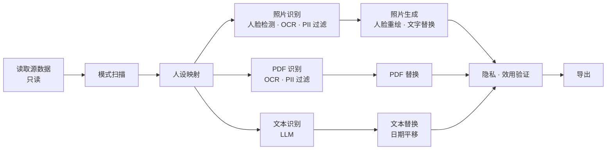

<div align="center">

[English](../../README.md) | [한국어](README.ko.md) | **简体中文** | [日本語](README.ja.md) | [Español](README.es.md) | [Français](README.fr.md) | [Deutsch](README.de.md)


# maskara

**maskara 不删除敏感数据，而是用一致的合成人设（persona）替换它，让数据依然可以用于 AI 训练。**

[在线演示](https://rl-mask.vercel.app) · [快速开始](#快速开始) · [工作原理](#工作原理) · [路线图](#路线图) · [参与贡献](#参与贡献)


[](../../LICENSE)


https://github.com/user-attachments/assets/9f8c173c-8290-444c-8a75-a590fc4b9fdb

</div>

---

## 简介

银行和医院的数据不能流出机构；即便允许流出，常规脱敏也会把值替换成 `[REDACTED]`，模型学习所需的上下文也随之消失。
maskara 只把能识别个人身份的值替换为**合成人设**，诊断、处方、日期间隔、表间关系等分析信息则原样保留。

| | 示例（合成数据） |
|---|---|
| 原始数据 | `Margaret Whitaker, 67F, seen 03/02/2024 with daughter Karen. MRN 004512.` |
| 常规脱敏 | `[NAME], [AGE], seen [DATE] with daughter [NAME]. MRN [ID].` |
| **maskara** | `Linda Moreno, 67F, seen 04/11/2024 with daughter Sofia. MRN 781203.` |

同一位患者无论出现在患者表、病历记录、PDF 文档还是照片中，都会被替换为**同一个人设**。每位患者的日期按相同幅度平移，因此就诊间隔得以保留。

## 功能

- **一致的人设映射**：每个人员键（例如 MRN）对应一个人设，该人员在所有表、文档和图像中都会被替换为同一个人设。
- **多模态处理**：一次运行即可处理三类输入。
  - 文本数据库：结构化列和自由文本记录
  - PDF：逐页 OCR，再以整份文档为上下文检测 PII
  - 照片：将人脸重绘为人设的面孔，图像中的文字也一并替换
- **AI 列策略建议**：AI 为每一列建议处理方式（保留、假名化、人设、日期平移等），由人工确认。
- **隐私与效用报告**：在输出中搜索残留的原始值，并用数字展示就诊间隔、年龄、表间关联和数据分布是否得以保留。
- **分析页面**：对原始数据和脱敏数据执行相同的查询（筛选、分组、聚合），并排对比结果。
- **内置示例数据**：一键加载合成医院数据、Synthea、Nemotron-PII 和 Nemotron-Personas 示例。
- **韩语 / 英语界面**，并为首次使用的用户提供引导教程

## 快速开始

### 环境要求

- Node.js 20.9 或更高版本
- pnpm 12（通过 `corepack enable` 启用）
- Anthropic API 密钥（用于自由文本 PII 检测和列策略建议）

### 安装与运行

```bash
git clone https://github.com/return-to-the-state/RLMask.git maskara
cd maskara
pnpm install
cp .env.example .env.local   # fill in MASKING_ANTHROPIC_API_KEY
pnpm dev                     # http://localhost:3000
```

### 第一次脱敏运行

1. 在侧边栏打开 **Datasets**，点击 **Load hospital sample**。
2. 在 **New masking job** 中检查 AI 为每一列建议的处理方式，然后运行。
3. 在运行结果的 **Privacy & utility** 标签页中，确认没有残留个人数据，且数据仍可用于分析。

打开应用时，引导教程会带你走一遍相同的流程。点击 **Skip tour** 即可跳过。

## 工作原理

数据集先经过共同的处理阶段，再分成三条通道（照片、PDF、文本），最后在验证阶段汇合。



| 阶段 | 模型 | MVP 中的运行位置 | 正式产品（本地部署）中的运行位置 |
|---|---|---|---|
| 读取源数据 | — | 浏览器 localStorage | 客户数据库，只读连接器 |
| 模式扫描 · 人设映射 | — | 浏览器 | 客户内网（映射表使用客户密钥加密） |
| 照片 · PDF 识别 | YuNet, indra-ocr, OpenAI privacy-filter, Stanford de-identifier | 团队 GPU 服务器 | 客户 GPU 服务器 |
| 照片生成 | SD 1.5 Inpainting, YuNet | 团队 GPU 服务器 | 客户 GPU 服务器 |
| 文本识别 | Claude | Anthropic API | 本地 LLM（vLLM） |
| 替换 · 验证 · 导出 | — | 浏览器 | 客户内网 |

为了尽快做出演示，MVP 只临时替代了两个部分：**数据存储（localStorage）和文本 LLM（Anthropic API）**。流水线的其余部分与正式产品使用相同的代码。完整设计见 [`planning/mvp.md`](../../planning/mvp.md)。

## 配置

环境变量写在 `.env.local` 中。完整列表见 [`.env.example`](../../.env.example)。

| 变量 | 必填 | 说明 |
|---|---|---|
| `MASKING_ANTHROPIC_API_KEY` | 是 | Anthropic API 密钥，用于自由文本 PII 检测和列策略建议 |
| `OCR_API_URL` | 否 | 识别照片和 PDF 中文字的 OCR 服务器 |
| `PRIVACY_FILTER_URL` | 否 | 在 OCR 文本中查找 PII 的 privacy-filter 服务器 |
| `FACE_API_URL` | 否 | 人脸检测服务器 |
| `FACE_REPAINT_URL` | 否 | 将人脸重绘为人设的服务器 |

GPU 服务器 URL 留空时，会使用团队的默认服务器。无法重绘人脸的照片会被标记为失败，而不会带着原始人脸被导出。

## 开发

| 命令 | 说明 |
|---|---|
| `pnpm dev` | 启动开发服务器（会先同步 README.ko.md 的背景部分） |
| `pnpm build` | 生产构建 |
| `pnpm start` | 运行构建产物 |
| `pnpm lint` | 运行 ESLint |
| `pnpm sync:readme` | 将 [`planning/subject.md`](../../planning/subject.md) 复制到 [README.ko.md](README.ko.md) 的背景部分 |

**技术栈：** Next.js 16 (App Router) · React 19 · TypeScript · Tailwind CSS 4 · shadcn/ui (Radix) · Zustand · React Query · Zod · Anthropic SDK

```text
src/
├── app/            # 页面（datasets、jobs、analysis、personas）和 API 路由
│   └── api/        # detect-pii、infer-roles、ocr、faces —— 所有外部模型调用都在服务端进行
├── components/     # 应用 UI 和 shadcn/ui 组件
└── lib/
    ├── pipeline/   # 阶段定义（stages.ts）、运行器（run.ts）、照片和 PDF 处理
    ├── pii/        # privacy-filter 集成、表单字段规则、检测准确率评估
    ├── llm/        # 基于 Claude 的 PII 检测和列角色分类
    ├── face/ ocr/  # 人脸重绘存储、OCR 客户端
    └── i18n/       # 英语（en.ts）和韩语（ko.ts）文案
public/samples/     # 内置示例数据集（均为合成或公开数据）
planning/           # 规划文档、调研资料、演示幻灯片
```

## 数据处理与安全

> [!WARNING]
> 当前 MVP 仅用于演示。**请勿放入真实的个人数据。**

- 自由文本会发送到 **Anthropic API**，照片和 PDF 页面会发送到 **GPU 服务器**。在正式产品中，两者都在客户内网中运行。
- 数据集、运行结果和人设只存储在浏览器的 localStorage 和 IndexedDB 中。
- 自动检测无法保证找出所有敏感数据。导出前请务必亲自检查隐私报告和输出结果。

如果发现安全漏洞，请不要公开提交 issue，而是通过 [GitHub Security Advisory](https://github.com/return-to-the-state/RLMask/security/advisories/new) 私下报告。

## 路线图

- [x] 三通道流水线：文本数据库、PDF、照片
- [x] 跨表、文档和图像的一致人设映射
- [x] 隐私与效用报告及分析对比页面
- [ ] 用客户数据库的只读连接器替代 localStorage
- [ ] 用客户 GPU 上的本地 LLM（vLLM）替代 Anthropic API
- [ ] 面向物理隔离网络的离线安装包
- [ ] 音频（通话录音）处理

## 背景

> 美国 RL 评测与数据公司愿意付费的服务（AttentionX 出题）

### 一句话介绍

用合成人设替换敏感数据，在保护个人信息的同时保留数据价值的服务。

### 服务简介

传统的数据脱敏会隐藏或删除敏感数据，在此过程中可能丢失分析所需的上下文。
本服务将人脸、姓名、年龄等个人信息替换为**一致的合成人设**。
在减少原始数据暴露的同时，保留数据的关键特征和关系，使其可用于 AI 训练、分析和测试。

### 要解决的问题

- 银行、医院等机构持有的数据**无法带出机构**，只能锁在各自内部。
- 金融 AI 公司需要这些数据来训练模型，却无从获取。
- 机构出售数据时必须脱敏，但传统脱敏会抹掉训练所需的上下文。

### 交付方式：本地部署

数据出不来，那就**我们去数据所在的地方。**

1. 以**只读**方式访问客户数据库。
2. 在客户环境内完成去标识化，原始数据绝不离开客户。
3. 只导出去标识化后的数据，用于训练或出售。

- 基于**本地 LLM** 运行。不调用任何外部 API，因此可在物理隔离网络中使用。
- 我们**销售可安装的软件**，而不是 SaaS。
- 需要针对每个客户的环境定制安装并持续更新，因此**部署工程**是业务的核心。

### 目标客户

- 需要训练数据的美国公司（RL 评测与数据公司）
- 持有数据但无法导出的机构（银行、医院）
- 需要用这些机构的数据训练模型的金融 AI 公司

更多调研资料见 [`planning/`](../../planning/)（韩语）：[市场分析](../../planning/market.html) · [客户调研](../../planning/customers.html) · [调研笔记](../../planning/research.html) · [构建计划](../../planning/build-plan.md)

## 参与贡献

欢迎提交 issue 和 PR。

1. 较大的改动请先提一个 [issue](https://github.com/return-to-the-state/RLMask/issues)，以便我们先就方向达成一致。
2. 在分支上开发，提交 PR 前请确保 `pnpm lint` 和 `pnpm build` 都能通过。
3. 提交信息请用英文，并使用祈使语气。例如：`Add date shift to the PDF lane`

须知：

- UI 文案需要**同时**添加到 `src/lib/i18n/en.ts` 和 `ko.ts`。
- 本 README 的源文件是英文版 [README.md](../../README.md)，各语言译本位于 `docs/i18n/README.<lang>.md`。修改源文件时，请同步更新译本。
- [README.ko.md](README.ko.md) 的背景部分由 [`planning/subject.md`](../../planning/subject.md) 生成。请编辑该文件而不是 README，然后手动更新其他 README 中翻译过的背景部分。
- 本项目使用 Next.js 16，其 API 与早期版本不同。编写代码前请先阅读 `node_modules/next/dist/docs/` 中的指南（参见 [`AGENTS.md`](../../AGENTS.md)）。

## 致谢

- AttentionX — 出题
- [Synthea](https://github.com/synthetichealth/synthea) (Apache-2.0) — 合成患者记录示例
- [NVIDIA Nemotron-PII](https://huggingface.co/datasets/nvidia/Nemotron-PII) · [Nemotron-Personas-USA](https://huggingface.co/datasets/nvidia/Nemotron-Personas-USA) (CC BY 4.0) — 附带 PII 标注答案的文档示例，以及人设示例

## 许可证

本项目以 [GNU Affero 通用公共许可证 v3.0](../../LICENSE) 发布。如果将修改后的版本作为网络服务运行，必须向该服务的用户提供其源代码。

`public/samples/` 中的示例数据集沿用各自的许可证（见[致谢](#致谢)）。
